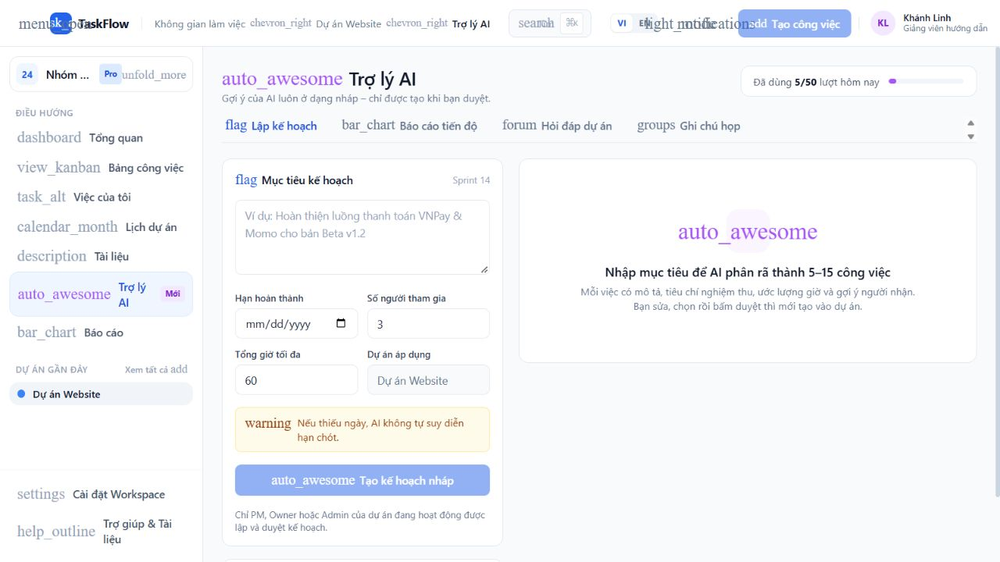
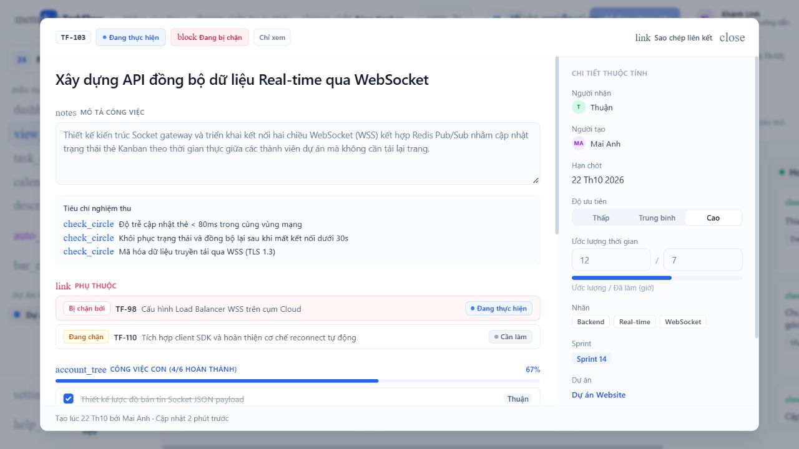
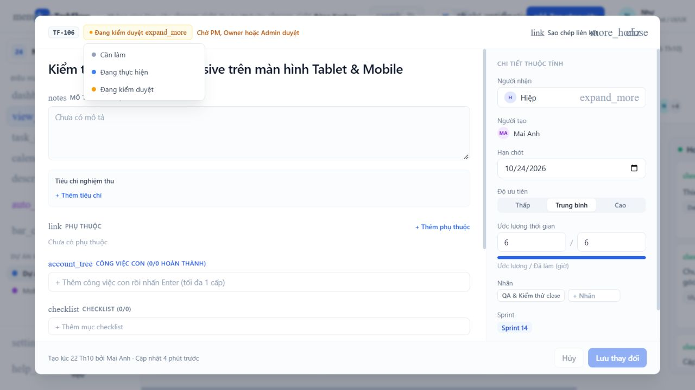
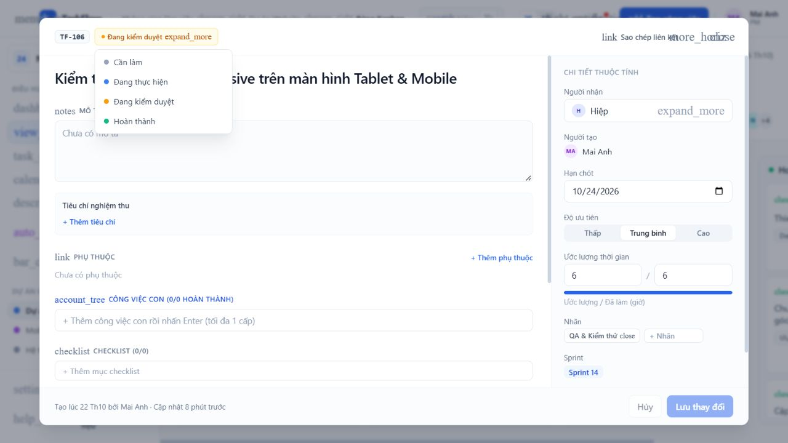
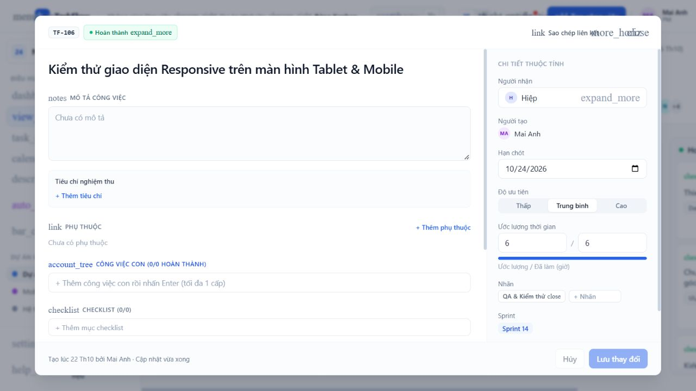
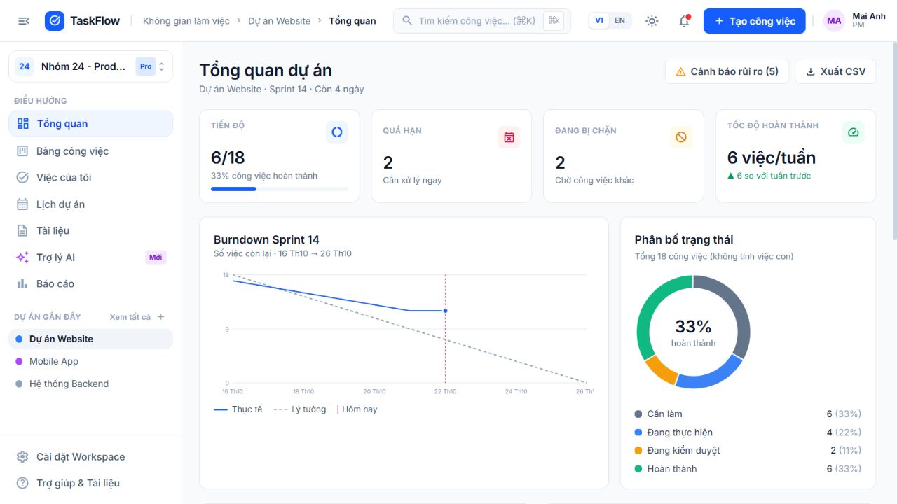
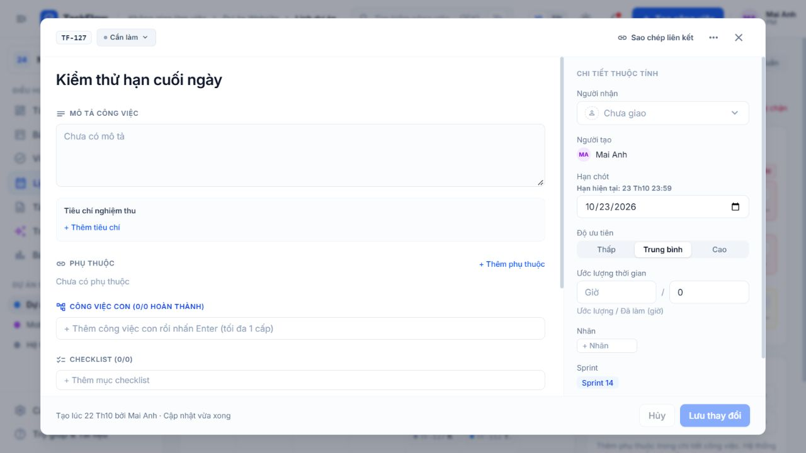
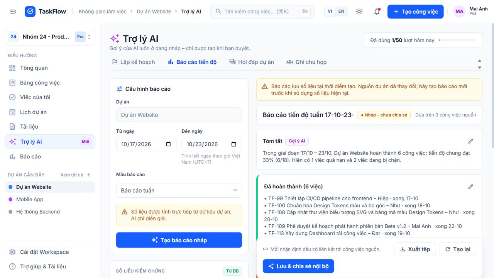

# Rà soát phân quyền và nghiệp vụ — nhánh Loc

Ngày kiểm tra: 22–23/10/2026. Mã nguồn: OJT202. Tài liệu yêu cầu: `DN26_CPL_Mock_Project_Nhom24.xlsx` trong Downloads, các sheet Product Backlog, Detail Plan, Solution Design và AI & Evaluation. Workbook chỉ được đọc, không cập nhật trạng thái hoàn thành.

## Kết luận và phạm vi

Đợt sửa này tập trung vào nghiệp vụ backend, phân quyền và kiểm thử thuộc phần Lộc, cùng các luồng frontend liên quan. Đã tạo nhánh `Loc` trước khi sửa. Không suy ra đóng góp cá nhân từ tài khoản seed hoặc tên người trong nhật ký demo; chúng là dữ liệu mô phỏng. Lịch sử Git ban đầu không đủ để xác nhận các chức năng cũ do Lộc viết.

Các lỗi đã xác nhận bên dưới đã được sửa và bổ sung hồi quy. Đây không phải chứng nhận toàn dự án đã đủ điều kiện nộp: đánh giá AI, UAT và các giới hạn cuối báo cáo vẫn cần theo dõi. Dependency đã được nâng và audit lại ở vòng 23/10.

## Lỗi đã sửa

| Mức ưu tiên | Lỗi và tác động trước sửa | Cách sửa / bằng chứng kiểm tra |
|---|---|---|
| P1 | Member tạo task Done hoặc chuyển Done trực tiếp, bỏ qua PM review | API create/PATCH/move chặn Done không đúng quyền; PM/Owner/Admin chỉ duyệt từ Review. UI tạo việc, kéo thả và chi tiết thống nhất |
| P1 | Viewer được bình luận qua API; tác giả xóa bình luận khi project archived | Tạo/sửa/xóa đều kiểm quyền ghi mới nhất trong transaction; UI ẩn ô gửi và thao tác sửa/xóa |
| P1 | Gỡ người khỏi nhóm/project còn task giao cho người đó, PM hoặc quyền phòng socket tồn dư | Cùng khóa workspace cho thay quyền/giao việc; bỏ giao task cha/con, tăng version, giữ audit, xóa PM; kiểm API, socket thực, download, AI và thông báo |
| P1 | Hai Owner tự hạ quyền đồng thời có thể làm mất Owner cuối | Đọc lại quyền và đếm Owner sau khi khóa; cập nhật cả owner_id của workspace; test hai yêu cầu đồng thời |
| P1 | Admin có thể tác động quyền cấp cao hoặc thay thế/gửi lại/thu hồi lời mời Admin | Chỉ Owner quản lý Owner/Admin; kiểm lại quyền trong transaction cả invite create/resend/revoke; resend vô hiệu token cũ |
| P1 | Một refresh token có thể được xoay thành nhiều phiên hợp lệ | Test trước sửa: 8 request đồng thời có 7 thành công. Sau sửa chỉ 1 lần xoay; phát hiện dùng lại thu hồi cả họ phiên và socket; thu hồi phiên/đổi mật khẩu/tạo phiên dùng cùng khóa user |
| P1 | Quota AI bị vượt bởi nhiều request đang chạy | Test trước sửa: dailyLimit=1 nhưng 5/5 request gọi dịch vụ. Sau sửa giữ chỗ `pending` trước khi gọi, chỉ 1 thành công và 4 trả 429; cập nhật cùng bản ghi khi kết thúc |
| P1 | Member dùng AI plan/apply hoặc sửa/chia sẻ báo cáo ngoài quyền PM | Thống nhất quyền PM/Owner/Admin ở API và UI; mất vai trò PM trong khi AI chạy thì không lưu/không trả draft/report |
| P1 | Q&A trả nguồn cũ khi nguồn bị xóa trong lúc AI xử lý | So sánh dấu kiểm nội dung nguồn trước/sau; trả 409 và không lưu câu trả lời cũ; kiểm quyền lại trong cùng khóa với thao tác lưu |
| P1 | Duyệt AI dở dang hoặc song song với gỡ assignee làm dữ liệu không nhất quán | Task, sequence, trạng thái draft và audit cùng transaction; duyệt lại không tạo trùng; assignee hiện tại phải thuộc dự án và không là Viewer |
| P1 | Hai dependency A→B và B→A đồng thời vượt kiểm tra chu trình | Kiểm chu trình và cập nhật trong cùng khóa workspace; test song song chỉ một hướng thành công |
| P1 | Khóa user/thu hồi phiên/audit tách rời; hai System Admin có thể khóa nhau | Transaction khóa theo thứ tự, kiểm lại quyền quản trị và ghi audit cùng thao tác; sau hai yêu cầu vẫn còn System Admin hoạt động |
| P2 | Dashboard, My Tasks, nhắc hạn và báo cáo tính overdue khác nhau | Thống nhất `dueDate < now && status != done`; không hạn không overdue; báo cáo không gắn nhãn “Đang chậm” cho việc chỉ sắp đến hạn |
| P2 | Capacity=0, thiếu estimate hoặc làm tròn % khiến cảnh báo quá tải sai | So sánh giờ thực trước làm tròn; 0 capacity + có việc vẫn báo quá tải; UI không hiển thị Infinity; báo số việc thiếu estimate |
| P2 | Hai câu hỏi đồng thời ghi đè mất một lượt hội thoại | Đọc bản hội thoại mới nhất và append trong transaction; hai câu mới giữ đủ 6 messages kể cả lượt ban đầu |
| P2 | Upload nhiều tệp lỗi giữa chừng để lại một phần dữ liệu | Kiểm toàn bộ lô trước khi ghi; DB/audit transaction; dọn tệp đã ghi nếu transaction thất bại |
| P2 | TXT đã sửa nhưng download vẫn trả file gốc; restore phiên bản không tồn tại báo thành công | Download text dùng nội dung hiện tại; restore sai trả 404; optimistic version chặn lưu bản cũ bằng 409 |
| P2 | Socket mất kết nối sau khi token hết hạn; nhiều tab refresh gây phát hiện reuse giả | UI xác thực/làm mới cookie trước reconnect; dùng Web Locks để tuần tự hóa refresh giữa các tab hỗ trợ API này |

P1 là cần xử lý trước nghiệm thu luồng liên quan; P2 là sai dữ liệu/nghiệp vụ hoặc trải nghiệm đáng kể. Các mức này là đánh giá của đợt review, không đồng nhất với điểm CVSS của npm audit.

## Bổ sung 23/10: sửa theo mức nghiêm trọng

| Ưu tiên | Lỗi đã xác nhận | Sửa và kiểm chứng |
|---|---|---|
| P1 | Link xác minh khác gửi trước đó vẫn tạo phiên sau khi tài khoản đã xác minh; tái hiện trả 200 thay vì 400 | Khóa user, xác minh + tiêu thụ mọi token verify trong transaction; token khác/concurrent chỉ một lần thành công; reset/đổi mật khẩu hủy cả token verify |
| P1 | bcrypt bỏ phần mật khẩu sau 72 byte; đăng ký trước sửa vẫn trả 201 | Chặn quá 72 byte UTF-8 ở tạo/reset/đổi mật khẩu, từ chối đăng nhập bằng chuỗi bị cắt; có test Unicode và ASCII |
| P1 | Production mặc định tự seed tài khoản demo với mật khẩu công khai, JWT ngắn vẫn được nhận | Mặc định production không seed; chặn cả lệnh seed trực tiếp; JWT ít nhất 32 ký tự; subprocess test cấu hình |
| P1 | Tin một proxy vô điều kiện khiến client trực tiếp giả X-Forwarded-For để đổi IP dùng cho rate limit | Mặc định không trust proxy; cấu hình IP/CIDR cụ thể bằng TRUST_PROXY; test giả header không đổi IP phiên |
| P1 | AI diễn giải rủi ro trả kết quả sau khi người gọi mất quyền hoặc nguồn thay đổi | Kiểm lại quyền và cảnh báo trong khóa workspace sau AI; test giữ request AI rồi thu hồi quyền/sửa task, nhận 404/409 và không lộ nội dung |
| P1 | Cảnh báo dependency High ở backend/frontend | Audit đầy đủ cả dev + production của BackEnd, FrontEnd, AIService hiện 0; Prisma generate/migration/test và build đều qua |
| P2 | Bỏ chọn Ghi nhớ đăng nhập vẫn giữ cookie 30 ngày | Lưu lựa chọn trong Session; cookie phiên và hạn DB 24 giờ khi bỏ chọn; chọn ghi nhớ tối đa 30 ngày; refresh giữ lựa chọn và hạn gốc |
| P2 | Date-only lưu đầu ngày; profile timezone bị bỏ qua; tuần lấy 7 ngày từ hôm nay | Hạn date-only hết ngày theo profile; timestamp có offset giữ nguyên; lịch/My Tasks dùng cùng múi giờ, tuần Thứ 2–Chủ nhật; test DST 23/25 giờ, năm mới, 3 múi giờ máy |
| P2 | Báo cáo cộng thêm 24 giờ dù to đã là timestamp; có thể lấy sang ngày sau | Mốc từ/đến rõ ràng, date-only theo giờ Việt Nam; test 16:59:59.999Z được lấy và 17:00:00Z bị loại |
| P2 | Sprint PATCH một đầu có thể đảo khoảng; khoảng rất dài làm burndown lặp hàng triệu ngày | Kiểm sau khi gộp PATCH; tối đa 367 điểm biểu đồ có ghi rõ lấy mẫu; Sprint một ngày chỉ một điểm |
| P2 | Lịch sử hỏi đáp/báo cáo không biết nguồn đã sửa/xóa; báo cáo tạo trong lúc dữ liệu đổi vẫn được lưu | Lưu revision nguồn, đánh dấu current/changed/unknown khi mở; khóa link nguồn không còn; report thay nguồn khi đang chạy trả 409; giữ nội dung snapshot |
| P2 | Sửa hai quy tắc rủi ro song song ghi đè lẫn nhau; resolve nhận key tùy ý, audit không cùng transaction | Khóa workspace, đọc quyền/dữ liệu mới nhất, chỉ resolve cảnh báo tồn tại; audit + thay đổi nguyên tử; phát sự kiện để cập nhật UI |
| P2 | page/limit âm, số thập phân hoặc quá lớn gây Prisma 500/lấy ngược bản ghi | Validate chung, trả 400; cap limit=100 và giới hạn offset; kiểm API tài liệu, My Tasks, nhật ký, notification |
| P2 | Font Google không tải làm icon thành chữ | Đóng gói Inter/Material Symbols cùng build; kiểm ảnh thật; chia riêng chunk AI/Documents/Admin để bundle chính dưới 500 kB |

Hai lỗi token verify và mật khẩu đã được tái hiện trước sửa bằng test thất bại (200/201 thay vì 400). Kết quả cuối: **95/95 backend + 16/16 AIService**, không bỏ qua. Xem [bằng chứng chạy](LOC_TEST_RESULTS.md).

## Bổ sung cuối vòng: biên bản, kế hoạch và dữ liệu AI

| Ưu tiên | Lỗi đã tái hiện / xác nhận | Sửa và kiểm chứng |
|---|---|---|
| P2 | Biên bản đọc `2027-02-15` thành ngày năm 2015; `31/02/2027` tự chuyển sang tháng 3 | Ưu tiên đọc ISO, kiểm ngày tồn tại, ngày sai hoặc thiếu tháng để trống; hạn đến cuối ngày theo profile; test năm nhuận, DST, timezone máy và HTTP → draft → task |
| P2 | Giới hạn 1 giờ nhưng kế hoạch nội bộ tạo tổng 9 giờ | Phân bổ theo đơn vị 0,01 giờ, không ép tối thiểu 1 giờ/việc; kiểm mức 1–5.000 giờ; output provider quá giờ hoặc estimate sai bị từ chối |
| P2 | Hạn kế hoạch bị cắt về 00:00 UTC; output AI có thể vượt ngày chót | Dùng cuối ngày profile, giữ giới hạn timestamp cụ thể; không nhận kế hoạch mới có hạn đã qua; provider trả ngày sai/vượt hạn bị từ chối |
| P2 | Sau sửa draft, có thể duyệt tổng giờ/hạn vượt giới hạn; duyệt 0 việc vẫn thành approved | Kiểm lại mục được chọn trước khi tạo task trong transaction; lỗi trả 400, không tạo một phần; tương thích draft cũ input=null và giữ idempotency |
| P2 | Narrative report lệch ngày khi host chạy UTC (23/10 thành 22/10) | Format theo Asia/Ho_Chi_Minh; test mốc `2026-10-22T17:00Z` thành 23/10 |
| P2 | Tên có ký tự regex làm trích biên bản sai; output provider thiếu title có thể tạo task rỗng | Escape tên trước so khớp; kiểm cấu trúc/title kết quả provider, có test stub phản hồi sai |
| P2 | Form sửa AI đóng dù API lưu thất bại; tổng giờ thập phân có đuôi sai số | Giữ form khi lỗi, chỉ đóng khi lưu thành công; hiển thị tổng tối đa 2 chữ số thập phân; build qua |

Biên bản dạng “ngày 15” thiếu tháng được để trống để người duyệt xác nhận. Ngày/tháng không có năm dùng năm hiện tại trong profile; tên thứ dùng lần xuất hiện kế tiếp. Không sửa ngầm deadline sai của các draft/task lịch sử. Kế hoạch mới lưu hạn tuyệt đối và timezone lúc tạo, nên đổi profile sau đó không đổi giới hạn kế hoạch. Draft có thể tạm vượt giới hạn khi đang sửa, nhưng không được duyệt cho đến khi giảm giờ/bỏ chọn hoặc sửa hạn.

## Quy ước ngày giờ và tương thích

- Ngày chót chỉ nhập YYYY-MM-DD: 23:59:59.999 trong timezone profile; giá trị lưu là thời điểm tuyệt đối. Ngày 22/10/2026 tại Việt Nam tương ứng `2026-10-22T16:59:59.999Z`.
- Thời điểm đầy đủ phải có Z hoặc offset; không nhận ngày không tồn tại hoặc timestamp thiếu múi giờ. Không đổi ngầm các deadline cũ đã lưu trong DB. Sửa task/AI item mà không đổi ngày giữ nguyên timestamp hiện có.
- Quota AI, dashboard, workload, report, ngày dự án/Sprint dùng `Asia/Ho_Chi_Minh`; My Tasks, lịch và thời gian hoạt động cá nhân dùng timezone profile. Đổi profile không làm đổi quota nhóm.
- Cookie không ghi nhớ là session cookie; một số trình duyệt có tính năng khôi phục phiên sau khi đóng. Vì vậy server vẫn giới hạn phiên không ghi nhớ tối đa 24 giờ, không tuyên bố đóng trình duyệt là thu hồi token tuyệt đối.
- Nâng Vite 6.4.5, React Router 7.18.4 và Tailwind 4.3.3; đổi PostCSS plugin, dùng @utility/@config theo [hướng dẫn Tailwind](https://tailwindcss.com/docs/upgrade-guide). Dùng @date-fns/tz 1.5.0 cho tính ngày theo múi giờ và DST ([API chính thức](https://github.com/date-fns/tz)).
- Giữ Prisma 6.19.3, override **chỉ** `@prisma/config → deepmerge-ts 8.0.2`. Major 8 đổi cách merge Map theo [release notes](https://github.com/RebeccaStevens/deepmerge-ts/releases/tag/v8.0.0); cấu hình dự án dùng object thông thường. Generate và migrate deploy trên DB mới cùng toàn bộ integration suite đã qua; không coi đây là chứng minh mọi Prisma config ngoài dự án đều tương thích.

## Quy tắc quyền hiện tại

PM là người quản lý của từng project, không phải role thứ năm ở workspace. Member chỉ được quyền PM trong project mà họ được gán quản lý. System Admin không tự được quyền đọc nội dung nhóm.

| Thao tác | Owner/Admin | Member là PM project | Member thường | Viewer |
|---|---|---|---|---|
| Đọc project | Trong workspace | Project được gán | Project được gán | Project được gán |
| Sửa task, checklist, dependency, bình luận, tài liệu | Có | Có | Có | Không |
| Duyệt Review → Done | Có | Có | Không | Không |
| Đổi thành viên/PM project | Có | Có trong project quản lý | Không | Không |
| Mời Member/Viewer workspace | Có | Không, trừ khi có role Admin/Owner | Không | Không |
| Quản lý role Owner/Admin | Chỉ Owner | Không | Không | Không |
| AI lập kế hoạch, biên bản, duyệt việc, tạo/sửa/chia sẻ report | Có | Có | Không | Không |
| AI Q&A, đọc báo cáo đã chia sẻ | Có trong quyền đọc | Có trong quyền đọc | Có trong quyền đọc | Có trong quyền đọc |

Dự án archived chặn thao tác thay đổi nội dung. Khôi phục project là thao tác quản trị riêng của PM/Owner/Admin. Q&A và xem báo cáo dùng quyền đọc. Bản nháp AI chỉ tác giả được sửa/duyệt, đồng thời tác giả phải còn quyền PM/Owner/Admin. Không tự chuyển quyền sở hữu draft cho người khác.

## Truy vết phần Lộc trong Excel

| Yêu cầu | Mã nguồn / bằng chứng trong đợt này | Ghi chú nghiệm thu |
|---|---|---|
| U003-T1; U004-T3; U005-T1 | routes/auth.js, routes/me.js, middleware/auth.js, services/sessions.js; test token, nhiều phiên, reset, whitelist profile | Cần kiểm thêm delivery email thật và rate limit với cấu hình production |
| U007-T1; U008-T3 | middleware/access.js, services/membership.js, routes/workspaces.js, routes/projects.js; test Owner cuối, Viewer, archived, revoke | Bao gồm socket thực, API, file, AI và notification |
| U009; U013-T1; U018 | routes/tasks.js; kiểm assignee, Review/Done, parent một cấp, xác nhận xóa cha, dependency | Task cha không tự Done do subtask/checklist |
| U014-T3 | Bình luận chỉ tác giả sửa/xóa; chặn Viewer/archived; lọc HTML | Chưa coi bộ test hiện có là fuzzing XSS đầy đủ |
| U019-T3; U026-T3 | services/metrics.js; test deadline, Done, không hạn, capacity=0, thiếu estimate, project trống, làm tròn | Cùng chuẩn thời điểm với My Tasks/report/reminder |
| U020-T4; U030-T3 | test/api.test.js; giao việc, API/socket/file/AI, thu hồi thành viên, transaction rollback | Chưa có buổi demo hai người và log backup/restore riêng |
| U027-T1 (Should) | Draft meeting dùng transaction/idempotency và quyền PM; kiểm ISO/ngày sai/cuối ngày profile, DST và tên có ký tự regex | Kiểm bằng AI nội bộ; không phải đánh giá provider thật |
| U028-T1 (Should) | routes/admin.js, services/realtime.js; khóa user, revoke, audit, cách ly nội dung | Test hai System Admin khóa nhau đồng thời |
| U032-T1; U034-T2; U035-T3 | Fixture bốn role ở test; hướng dẫn/ảnh bên dưới | Chưa thay thế UAT, rehearsal và review chéo của người thật |

## Chạy lại kiểm thử và triển khai thay đổi

Từ thư mục gốc OJT202:

```powershell
npm run install:all
npm test
npm run build
git diff --check
```

Test tự khởi tạo PostgreSQL tạm thời và AIService nội bộ, không dùng database dev/production và không gọi Claude trả phí. Có các ca cố ý gây AI unavailable và lỗi DB giữa chừng để chứng minh rollback; log lỗi dự kiến của các ca đó không có nghĩa suite thất bại. Xem tổng `pass/fail` ở cuối.

Ba migration mới (không xóa bảng/dữ liệu):

- `20261022090000_ai_pending`: thêm trạng thái pending để giữ quota khi AI đang chạy.
- `20261022110000_ai_source_revision`: thêm revision nguồn cho report; bản cũ để null và hiển thị unknown.
- `20261023010000_session_remember`: thêm lựa chọn ghi nhớ; phiên cũ giữ hành vi persistent, phiên mới theo lựa chọn đăng nhập.

Dừng backend trước khi cài/generate trên Windows để tránh khóa DLL Prisma. Giữ thư mục `shared/` cạnh BackEnd/FrontEnd/AIService khi đóng gói dự án. Khởi động backend áp dụng migration bằng cơ chế migrate deploy sẵn có. Cần chạy install/generate Prisma client sau khi lấy code mới. Không sửa migration init đã tồn tại.

Lượt AI pending vẫn tính quota khi tiến trình chết giữa lúc xử lý. Đây là cách giữ hạn mức bảo thủ; chưa có job đổi pending cũ thành interrupted. Không được coi pending là lỗi AI trong thống kê errors.

Kết quả kiểm thử cuối cùng được ghi trong `LOC_TEST_RESULTS.md`. Ảnh là từ bản build chạy thật trên database demo tạm thời, không phải ảnh thiết kế.

## Những điểm còn thiếu hoặc chưa được chứng minh

1. **RAG chưa có embedding/pgvector theo Solution Design.** Q&A đang truy xuất theo từ khóa. Kiểm quyền, revision và trích dẫn đã sửa, nhưng không được trình bày như đã có pipeline vector retrieval.
2. **Chưa nghiệm thu AI 40 câu có đáp án + 10 câu thiếu dữ liệu + 20 ca quyền/injection, hai người chấm.** Bộ test tự động không thay cho đo chất lượng provider thật.
3. **Vận hành:** chưa đo p95 với 50 user/1.000 task; chưa có diễn tập backup/restore, SMTP thật, reverse proxy/HTTPS và nhiều instance. Mailer hiện là outbox demo; production cần nối nhà cung cấp email trước khi nghiệm thu đăng ký/reset qua email. TRUST_PROXY phải khớp hạ tầng thực tế.
4. **UAT/rehearsal:** chưa có nghiệm thu độc lập của bốn vai trò và buổi demo hai người. Ảnh UI là smoke test trên dữ liệu tạm, không phải chữ ký nghiệm thu.
5. **Giới hạn snapshot:** cảnh báo revision được tính khi mở/lấy lại hoặc tạo câu trả lời/báo cáo. Một màn hình đang mở không tự quét mọi snapshot theo từng thay đổi; thời gian tự trôi cũng làm chỉ số overdue thay đổi dù nguồn chưa sửa. UI ghi rõ số liệu tại thời điểm tạo. Bản cũ không có revision được đánh dấu unknown.
6. **Môi trường:** đã test múi giờ/DST và browser hiện tại, chưa phủ mọi trình duyệt, trình duyệt thiếu Web Locks, hay nhiều instance socket. Deadline cũ giữ nguyên timestamp; không tự suy đoán ý định lịch sử để đổi hạn hàng loạt.

Dependency, icon và các lỗi ngày giờ xác nhận ở vòng trước đã được xử lý; chúng không còn nằm trong danh sách lỗi chưa sửa. Không kết luận dự án tuyệt đối không còn lỗi từ số test pass hoặc npm audit.

## Hướng dẫn kiểm tra nhanh theo vai trò

- **Owner/Admin:** mở Cài đặt Workspace → Thành viên; kiểm tra role và lời mời. Chỉ Owner được quản lý role cấp cao. Khi gỡ người, công việc được bỏ giao và PM được xóa nếu cần; lịch sử vẫn còn.
- **PM:** trong project đang quản lý, kiểm tra công việc ở Review rồi chọn Hoàn thành. Trong Trợ lý AI, tạo bản nháp, rà soát nội dung/người nhận/ngày trước khi duyệt. Duyệt lại cùng draft không tạo trùng task.
- **Member:** làm task, checklist và bình luận; chuyển sang Review để PM duyệt. Không có tùy chọn Done khi đang Review; không được tạo/duyệt kế hoạch AI trong project không quản lý. Được hỏi đáp trong quyền đọc.
- **Viewer:** đọc task/tài liệu/báo cáo và hỏi đáp trong project được gán; không có ô gửi bình luận hoặc quyền sửa task. Không thể tạo/duyệt kế hoạch AI.
- **Kiểm thu hồi:** mở tài khoản thành viên ở cửa sổ khác, Owner gỡ quyền; thử tải file, gọi API, vào lại socket room và hỏi AI. Kết quả phải không trả nội dung project ngoài quyền. Bộ test dùng các client và socket độc lập để xác nhận các luồng này.











## Ảnh sau vòng sửa bổ sung

Ảnh phân quyền phía trên được giữ làm bằng chứng vòng đầu (khi font bên ngoài chưa tải). Ảnh dưới dùng font đóng gói cục bộ và bản build mới:






