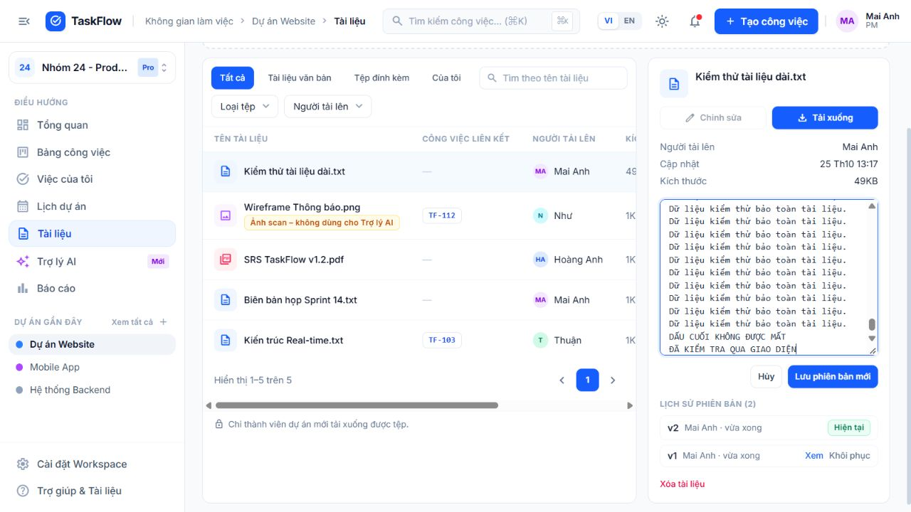
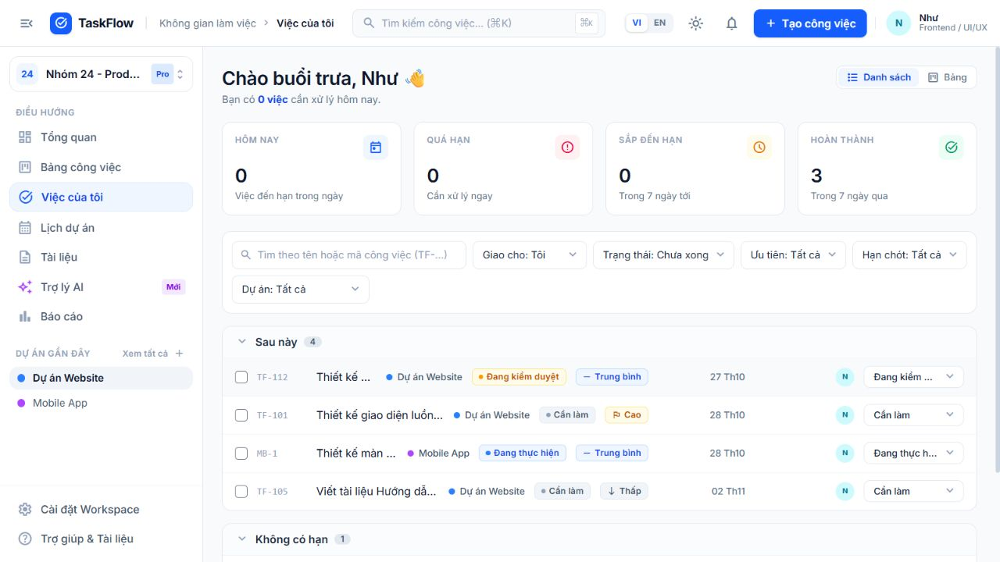

# Rà soát và sửa lỗi tiếp — 25/10/2026

## Phạm vi và cách kiểm tra

Kiểm tra mã nguồn hiện có trên `main`, tập trung vào các luồng liên quan phần Lộc: quyền workspace/project, xác thực và phiên, công việc, tài liệu và các màn hình dùng các API này. Không suy luận tác giả của mã nguồn từ tên tài khoản demo. Không cập nhật trạng thái nghiệm thu trong Excel.

Trước sửa, bộ test cũ đạt **95 backend + 16 AIService**. Sau sửa, bộ test đạt **102 backend + 16 AIService + 7 frontend = 125**, không thất bại hoặc bỏ qua. Các ca backend dùng PostgreSQL thật trong thư mục tạm. AIService dùng bộ xử lý nội bộ, không gọi provider trả phí.

## Lỗi đã sửa, từ nặng đến nhẹ

| Mức | Lỗi trước sửa và ảnh hưởng | Thay đổi và kiểm chứng |
|---|---|---|
| **P1 — phân quyền** | Admin qua middleware rồi bị Owner hạ xuống Member vẫn đổi tên workspace được. Tái hiện có kiểm soát thời điểm cho kết quả **200 thay vì 403**. | Khóa workspace, đọc lại membership bên trong transaction trước cập nhật. Ghi nhật ký cùng transaction. Ca hồi quy nhận 403 và tên workspace không đổi. |
| **P1 — mất nội dung** | Editor tài liệu khởi tạo từ `preview`, trong khi API cắt preview ở **20.000 ký tự**. Lưu sẽ thay toàn bộ tài liệu bằng đoạn này. | API `/documents/:id/content` cung cấp nội dung đầy đủ và version. Editor dùng dữ liệu này, giữ version lúc mở sửa để phát hiện xung đột. API vẫn kiểm quyền đọc; mất membership nhận 404. UI đã thử tài liệu 36.023 ký tự, sửa thành 36.049 rồi mở lại còn nguyên dấu cuối. |
| **P1 — tải xuống thiếu dữ liệu** | TXT upload chỉ cache 200.000 ký tự nhưng download dùng cache thay tệp gốc. Test tải tệp **210.008 ký tự chỉ nhận 200.000** trước sửa. | Bản upload chưa chỉnh sửa được tải từ tệp gốc, bảo toàn byte. Editor đọc đầy đủ UTF-8 trước khi sửa. Tệp quá giới hạn chỉnh sửa bị từ chối rõ ràng, không cho lưu đè từ phần cache; vẫn tải xuống và đổi tên được. |
| **P2 — văn bản bị biến đổi** | Bộ lọc HTML và `trim()` làm mất markup, khoảng trắng, xuống dòng khi tạo/lưu tài liệu văn bản. | Tài liệu được giữ nguyên dưới dạng text; React render bằng text node/textarea, download dưới MIME text/plain và nosniff. Test giữ nguyên `<script>`, `<T>`, CRLF và khoảng trắng; NUL trong nội dung chỉnh sửa trả 400. Không thay quy tắc lọc bình luận. |
| **P2 — không khôi phục được TXT gốc** | TXT upload không có revision đầu tiên; sau chỉnh sửa không thể khôi phục v1. | Trước thay đổi đầu tiên, lưu snapshot đầy đủ của bản gốc cùng transaction; giữ nguyên nội dung khi restore. Hiển thị lịch sử cho cả TXT upload. Test sửa rồi restore v1 đạt. |
| **P2 — ghi đè tên từ bản cũ** | Đổi tên không tăng version, nên form cũ tiếp tục ghi đè tên mới. Test nhận version 1 thay vì 2. | Cả đổi tên và sửa nội dung đều tăng version; form cũ nhận 409. Lưu revision của tài liệu text đồng bộ với version mới. |
| **P2 — dữ liệu giao diện cũ** | Chọn tài liệu/task khác hoặc đổi project có thể giữ form và bản xem trước của mục trước; workspace cũ vẫn được sử dụng trong lúc tải workspace mới. | Reset component theo ID tài liệu/task/project. Workspace snapshot gắn với user và workspace hiện tại; bỏ qua response của phạm vi cũ. Vô hiệu request `/me` cũ khi đăng xuất/hết phiên, dọn bộ đếm và dữ liệu phiên. UI kiểm đổi project sang project rỗng, đổi workspace sang workspace rỗng và đổi tài khoản đạt. |
| **P2 — Việc của tôi sai thao tác duyệt** | Checkbox luôn gửi Done; Member bị backend từ chối, PM có thể chọn Done từ trạng thái chưa Review; project archived vẫn hiện thao tác ghi. | API trả `canWrite/canManage` theo từng project. Checkbox gửi Review cho việc chưa duyệt; Review chỉ PM/Owner/Admin mới duyệt Done; Member chờ duyệt; Viewer/archived chỉ xem. Menu chỉ có trạng thái được phép. Test API các vai trò và test frontend quy tắc chuyển trạng thái đạt; Member đã thao tác thật trên UI. |
| **P2 — đếm trùng công việc** | Lời chào cộng số đến hạn hôm nay và số quá hạn, đếm hai lần việc đã quá hạn trong hôm nay. | Backend tính `summary.actionable` bằng hợp của hai tập, frontend dùng trực tiếp; test một việc quá hạn cho kết quả một. Nhãn sắp đến hạn đổi thành “Từ nay đến cuối tuần” để khớp khoảng dữ liệu hiện có. |
| **P2 — đăng xuất nhầm khi lỗi mạng** | Sau 401 ban đầu, `/me` hoặc refresh gặp lỗi máy chủ vẫn bị diễn giải thành hết phiên; lỗi mạng ở refresh/retry thoát ra dưới dạng TypeError. | Chỉ refresh khi `/me` trả 401; phân biệt lỗi server/mạng với hết phiên thật. Không phát sự kiện đăng xuất do 503. Chuẩn hóa lỗi mạng thành ApiError. Test 503, lỗi mạng, 401 thật và nhiều request refresh đồng thời đạt. |
| **P3 — tham số revision** | `parseInt` nhận `1abc`, `1.5` như revision 1; số lớn vượt kiểu DB có thể gây 500. | Validate số nguyên dương và giới hạn int32; tham số đường dẫn không hợp lệ nhận 404, body không hợp lệ nhận 400. |

P1/P2/P3 là mức ưu tiên sửa trong lần rà soát, không phải điểm CVSS.

## Bằng chứng

- [Test trước sửa nhóm tài liệu](test-evidence/2026-10-25-before-fixes.txt): lỗi tải TXT bị cắt, thiếu revision v1, đổi tên không tăng version. Test editor mới còn nhận 404 vì endpoint chưa tồn tại; nguyên nhân editor mất dữ liệu được xác định từ mã nguồn và kiểm lại bằng UI sau sửa.
- [Tái hiện riêng lỗi quyền trước sửa](test-evidence/2026-10-25-before-access-fix.txt): 200 thay vì 403. Lần thử đầu của ca này gặp giới hạn mock trên Prisma proxy; đã sửa harness rồi chạy lại riêng trước khi sửa ứng dụng.
- [Toàn bộ test sau sửa](test-evidence/2026-10-25-tests.txt): 16 AIService, 102 backend, 7 frontend đạt. Các log lỗi AI unavailable/rollback do suite chủ động gây ra vẫn là tình huống kiểm thử dự kiến.
- [Build cuối](test-evidence/2026-10-25-build.txt): thành công, 124 modules; bundle chính khoảng 460,62 kB (gzip 135,11 kB).
- `git diff --check`: đạt.
- Browser smoke: production build chạy ở localhost với DB demo tạm; đăng nhập Owner và Member, sửa/mở lại tài liệu dài, chuyển project/workspace, gửi Review từ My Tasks; console ở lượt kiểm cuối không ghi lỗi.

Ảnh tài liệu đã lưu và mở lại, giữ phần cuối:



Ảnh Member sau khi gửi kiểm duyệt, không được tự duyệt Done:



## Chạy lại

```powershell
npm test
npm run build
git diff --check
```

`npm test` hiện bao gồm frontend. Các test mới bổ sung 7 ca backend và 7 ca frontend. Test API hiện cách ly cả thư mục upload vào thư mục tạm và dọn sau khi chạy, thay vì để các file kiểm thử phát sinh trong thư mục upload dev.

Có thể chạy `node scripts/review-smoke.mjs` sau build để tạo môi trường kiểm tra UI riêng tại `http://localhost:4179`. Script dùng DB và thư mục upload tạm, tạo tài liệu dài, task Review và workspace rỗng; gõ `stop` trong terminal hoặc Ctrl+C để dừng. Có giới hạn tự dừng sau 20 phút. Không dùng script này để triển khai production.

## Giới hạn và dữ liệu cũ

- Không có migration DB trong lần sửa này. Cần build frontend và khởi động lại backend để dùng đồng bộ API mới.
- Giới hạn chỉnh sửa trực tuyến vẫn là **200.000 ký tự**, upload vẫn tối đa 10 MB/tệp. TXT lớn hơn giới hạn hoặc không phải UTF-8 hợp lệ giữ khả năng tải xuống nguyên bản; không cố sửa từ nội dung đã cắt/giải mã lỗi.
- Không tự động phục hồi các tài liệu đã bị cắt ở lần lưu trước đây. Tệp gốc còn lưu hoặc revision cũ có thể dùng để đối chiếu và khôi phục riêng; không tự ghi đè dữ liệu người dùng.
- Đã kiểm toàn bộ suite hiện có và smoke các luồng thay đổi, chưa phải UAT độc lập hoặc chứng minh toàn dự án hết lỗi. Chưa đo tải, kiểm đa instance, SMTP thật, backup/restore hoặc chất lượng provider AI; các giới hạn trong báo cáo 23/10 vẫn áp dụng.
- Không chạy lại npm audit trong lượt này và không thay dependency. Kết quả audit ngày 23/10 không được diễn giải thành kết quả của hôm nay.

Tại thời điểm kết thúc lượt rà soát, các sửa đổi nằm trong working tree và chưa commit/push. Theo yêu cầu tiếp theo, đã chạy lại kiểm tra trước khi đưa lên `Loc` rồi cập nhật `main`: [125 test đạt](test-evidence/2026-10-25-pre-push-tests.txt), [build đạt](test-evidence/2026-10-25-pre-push-build.txt), `git diff --check` đạt. Trạng thái phát hành chính xác được ghi trong lịch sử Git của hai nhánh.
