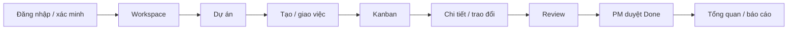

# Hoàng Thị Hải Như — công việc đến 28/10/2026

Cập nhật 29/10: đã đồng bộ phần này với main `8aa32ab`; xem [kết quả hợp nhất và kiểm tra mới](NHU_MERGE_MAIN_2026-10-29.md). Các số liệu bên dưới giữ nguyên theo lần kiểm tra ngày 28/10.

## Phạm vi

Đối chiếu bản `DN26_CPL_Mock_Project_Nhom24 (1).xlsx` người dùng cung cấp, sheet `Detail Plan` dòng 12, 13, 16, 21, 23, 27, 35, 38, 39; `Sprint 1` dòng 13. Bản triển khai trên nhánh `Nhu`, nền ban đầu `da5fc0a`.

Đây là báo cáo thay đổi và kiểm tra sản phẩm, không xác nhận danh tính tác giả của code đã có. Không sửa Excel hoặc ký thay người review. Workbook ghi U010 Done nhưng các subtask Open; chỉ cập nhật sau khi nhóm đối chiếu bằng chứng.

## Nhiệm vụ trực tiếp

| Task / hạn | Đầu ra và kiểm tra |
| --- | --- |
| U002-T2 / 19/10 | Router, layout, API client và test mock đã có. Bổ sung TypeScript entry `main.tsx`, `tsconfig.json`, kiểu Vite, `typecheck`, ESLint và bước lint/typecheck trong CI. Frontend hiện dùng JS/JSX và TSX cùng nhau (`allowJs`), chưa chuyển toàn bộ component sang TypeScript. |
| U004-T2 / 20/10 | Login, protected routes, tự refresh cookie và logout đã có. Test client xác nhận refresh 503 không đăng xuất, 401 thật mới kết thúc phiên, nhiều request chỉ refresh một lần. E2E kiểm tra đăng ký/xác minh/login và logout quay về login khi mở `/board`. |
| U006-T3 / 21/10 | Chạy bộ API trên PostgreSQL tạm: người ngoài workspace đoán ID bị 404; Admin ngoài project private không đọc task/file/metrics/search/activity; thu hồi quyền có hiệu lực trên API/socket/file/AI. Các expected/actual nằm trong assertion của `BackEnd/test/api.test.js`, kết quả trong log. |
| U009-T2 / 28/10 | Form và chi tiết task tích hợp API thật: người nhận, ưu tiên, hạn chót theo timezone, version concurrency. Khóa tạo khi chưa tải quyền/không phải PM, khóa gửi lặp, giữ form khi lỗi, hiển thị lỗi trường. Sửa tải nền ghi đè draft; giữ bản gốc và version khi 409; người dùng chọn Tải lại mới bỏ nội dung chưa lưu. Bổ sung nhãn truy cập và nút đóng/thử lại khi tải chi tiết lỗi. |
| U010-T2 / 26/10 | Giữ kéo thả; thêm nút mở task và select đổi trạng thái dùng được bằng bàn phím. Giới hạn trạng thái theo quyền PM/Member/Viewer và trạng thái archived. Khóa move lặp; rollback chỉ thẻ thất bại, không làm mất cập nhật thẻ khác hoặc version realtime mới hơn. |

Reviewer theo kế hoạch: Hiệp review U002-T2/U004-T2/U009-T2, Lộc review U006-T3, Thuận review U010-T2. Báo cáo này cung cấp phần kiểm tra kỹ thuật để họ review; không thay kết luận của các reviewer đó.

## Ma trận kiểm tra

| Ca | Expected | Actual |
| --- | --- | --- |
| Form tạo task gửi ưu tiên/hạn và nhận lỗi assignee | Payload đúng; không mất nội dung; hiển thị lỗi trường | Đạt qua component test |
| Bấm Tạo hoặc move lặp khi đang chờ | Một request cho cùng thao tác | Đạt qua component test |
| Chưa tải quyền tạo task | Không gửi request ghi | Đạt qua component test |
| Viewer mở board | Không kéo thả hoặc chọn trạng thái | Đạt qua component và API test |
| Move A lỗi trong khi B thành công | A rollback; B giữ trạng thái/version mới | Đạt qua component test |
| Tải realtime bắt đầu trước khi nhập | Không ghi đè draft mới nhập hoặc base version | Đạt qua component test |
| Hai tab sửa cùng task | Tab sau bị 409; draft còn nguyên; Tải lại lấy bản server | Đạt qua component test và Edge E2E |
| Bàn phím trên board | ArrowDown/Enter đổi trạng thái, Enter mở chi tiết | Đạt trên Edge headless |
| API move 503 | Hiện lỗi và trả thẻ về trạng thái cũ | Đạt trên Edge headless |
| Reload sau chuyển trạng thái | Đọc lại đúng trạng thái đã lưu DB | Đạt trên Edge headless |
| Member gửi Review, PM duyệt Done/reopen | Không tự duyệt Done; completedAt đúng | Đạt qua API và Edge E2E |
| Logout rồi mở `/board` | Chuyển tới login | Đạt trên Edge headless |

Test mới: `FrontEnd/test/nhu-sprint1.test.js` và kịch bản Như trong `test/e2e/sprint1.test.mjs`.

## Các phần được giao review

| Task | Kết quả đối chiếu |
| --- | --- |
| U001-T1 — khảo sát, pain points, so sánh công cụ | Chưa có phiếu/biên bản khảo sát ≥6 người/2 nhóm trong repo để kiểm chứng. Cần Hoàng Anh cung cấp đầu ra thật; không tự tạo người trả lời hoặc kết quả. |
| U001-T2 — journey và wireframe | Có thể đối chiếu luồng đang chạy bên dưới; chưa có bản wireframe gốc được đánh phiên bản trong repo để xác nhận review tài liệu của Hiệp. |
| U003-T3 — test xác minh email | Suite API kiểm email trùng không phân biệt hoa thường, xác minh một lần, token hết hạn/dùng lại, dữ liệu sai. Toàn suite đạt; email thật/SMTP không được kiểm trong lượt này. |
| U010-T3 — test Kanban | Kiểm lại reload, 409 hai tab, Viewer, rollback và lưu trạng thái. Component/API/E2E đạt các ca nêu trong ma trận. |

Luồng giao diện đối chiếu U001-T2:



Luồng tạo việc phải có người nhận thuộc dự án, ưu tiên và hạn có thể để trống; Viewer chỉ xem. Khi lưu thất bại, nội dung nhập cần còn nguyên. Các nhánh loading/error/empty phải hiển thị rõ. Luồng AI/dashboard/cộng tác ngoài phạm vi kỹ thuật tới 28/10 không được nhận là phần mới hoàn thành trong lượt này.

## Bằng chứng chạy

- `test-evidence/2026-10-28-nhu-tests.txt`: 178/178 — AIService 16, backend 124, frontend 38; không skip. DB và upload tạm, AI nội bộ, không sử dụng DB phát triển hay provider trả phí.
- `test-evidence/2026-10-28-nhu-frontend-final.txt`: frontend 38/38 sau các chỉnh sửa nhãn/thuộc tính cuối.
- `test-evidence/2026-10-28-nhu-lint.txt`: ESLint không có lỗi; 4 cảnh báo directive cũ không được sử dụng, không tự sửa các file ngoài phạm vi.
- `test-evidence/2026-10-28-nhu-typecheck.txt`: TypeScript typecheck đạt trong cấu hình JS/TS cùng tồn tại; JS cũ không được kiểm kiểu (`checkJs: false`).
- `test-evidence/2026-10-28-nhu-build.txt`: production build đạt.
- `test-evidence/2026-10-28-nhu-e2e.txt`: hai kịch bản Edge E2E, dùng DB riêng và chặn mạng ngoài server test; không có page error.
- `screenshots/2026-10-28-nhu-kanban.png`, `screenshots/2026-10-28-nhu-task-detail.png`: ảnh từ E2E trên bản chạy thật.

CI được cấu hình chạy các bước, nhưng kết quả local không thay cho trạng thái GitHub Actions sau push.

## Khởi động và tái kiểm tra

```powershell
npm ci
npm --prefix BackEnd ci
npm --prefix AIService ci
npm --prefix FrontEnd ci
npm --prefix FrontEnd run lint
npm --prefix FrontEnd run typecheck
npm test
npm run test:e2e
```

Node 24; Windows E2E mặc định dùng Edge. PostgreSQL Windows khởi động bằng `pg_ctl` để hạ quyền tiến trình thay vì chạy `postgres.exe` trực tiếp trong terminal elevated. Khi disconnect, dừng server trước rồi mới xóa thư mục ephemeral đã kiểm tra đường dẫn. Production dùng DATABASE_URL không đi qua nhánh PostgreSQL nhúng.

## Daily Scrum đề xuất sau khi kiểm tra

Không điền ngược “hôm qua” hoặc tự xác nhận thời gian tham gia họp. Có thể dùng nội dung sau ở mục cập nhật hiện tại: “Đã đối chiếu phần frontend Sprint 1; bổ sung thao tác Kanban bằng bàn phím, rollback an toàn, chặn gửi lặp và bảo toàn nội dung task khi xung đột. Đã chạy test API, component, E2E và build; gửi nhánh Nhu để review. Còn cần đầu ra khảo sát/wireframe gốc và xác nhận reviewer theo phân công.”
