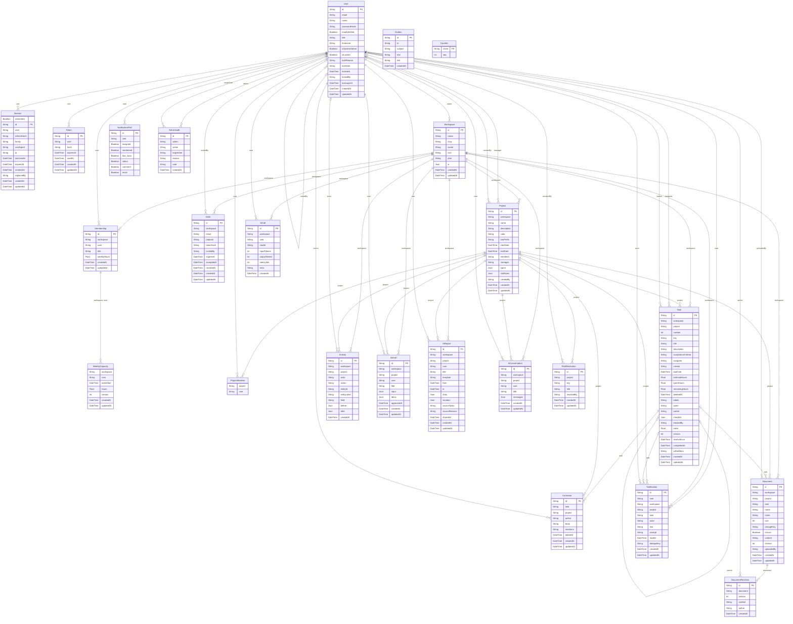

# ERD và từ điển dữ liệu

Version 2026-10-30. Sinh từ `BackEnd/prisma/schema.prisma`; SQL migration là nguồn triển khai. Mảng UUID và JSONB không tự tạo FK; quan hệ bên dưới chỉ lấy từ `@relation(fields:...)` thật.



## Bảng và ràng buộc

### User

```prisma
model User {
  id            String    @id @default(dbgenerated("gen_random_uuid()")) @db.Uuid
  email         String    @unique
  name          String    @db.VarChar(80)
  passwordHash  String
  emailVerified Boolean   @default(false)
  title         String    @default("")
  timezone      String    @default("Asia/Ho_Chi_Minh")
  language      Language  @default(vi)
  isSystemAdmin Boolean   @default(false)
  isLocked      Boolean   @default(false)
  lockReason    String?
  lockNote      String?
  lockedAt      DateTime?
  lockedBy      String?   @map("locked_by_id") @db.Uuid
  lastLoginAt   DateTime?
  createdAt     DateTime  @default(now())
  updatedAt     DateTime  @updatedAt

  lockedByRef        User?              @relation("UserLockedBy", fields: [lockedBy], references: [id], onDelete: SetNull)
  lockedUsers        User[]             @relation("UserLockedBy")
  sessions           Session[]
  tokens             Token[]
  ownedWorkspaces    Workspace[]
  memberships        Membership[]
  invitesSent        Invite[]
  projectsManaged    Project[]          @relation("ProjectManager")
  projectsCreated    Project[]          @relation("ProjectCreator")
  projectMemberships ProjectMember[]
  tasksAssigned      Task[]             @relation("TaskAssignee")
  tasksCreated       Task[]             @relation("TaskCreator")
  comments           Comment[]
  documents          Document[]
  revisions          DocumentRevision[]
  notifications      Notification[]     @relation("NotificationRecipient")
  notificationsActed Notification[]     @relation("NotificationActor")
  notificationPref   NotificationPref?
  activities         Activity[]
  aiCalls            AiCall[]
  aiDrafts           AiDraft[]
  aiReports          AiReport[]
  aiConversations    AiConversation[]
  riskResolutions    RiskResolution[]
  auditsDone         AdminAudit[]       @relation("AuditAdmin")
  auditsReceived     AdminAudit[]       @relation("AuditTarget")

  @@map("users")
}
```

### Session

```prisma
model Session {
  remember Boolean @default(true)
  id          String    @id @default(dbgenerated("gen_random_uuid()")) @db.Uuid
  user        String    @map("user_id") @db.Uuid
  refreshHash String
  family      String
  userAgent   String?
  ip          String?
  lastUsedAt  DateTime  @default(now())
  expiresAt   DateTime
  revokedAt   DateTime?
  replacedBy  String?
  createdAt   DateTime  @default(now())
  updatedAt   DateTime  @updatedAt

  userRef User @relation(fields: [user], references: [id], onDelete: Cascade)

  @@index([user])
  @@index([refreshHash])
  @@index([family])
  @@map("sessions")
}
```

### Token

```prisma
model Token {
  id        String    @id @default(dbgenerated("gen_random_uuid()")) @db.Uuid
  user      String    @map("user_id") @db.Uuid
  type      TokenType
  hash      String    @unique
  expiresAt DateTime
  usedAt    DateTime?
  createdAt DateTime  @default(now())
  updatedAt DateTime  @updatedAt

  userRef User @relation(fields: [user], references: [id], onDelete: Cascade)

  @@index([user])
  @@map("tokens")
}
```

### Workspace

```prisma
model Workspace {
  id        String   @id @default(dbgenerated("gen_random_uuid()")) @db.Uuid
  name      String   @db.VarChar(80)
  slug      String   @unique
  owner     String   @map("owner_id") @db.Uuid
  size      String   @default("6-10")
  plan      String   @default("Pro")
  /// { enabled, dailyLimit, timeoutSec, features: { planner, report, qa, risk, meeting } }
  ai        Json     @default("{\"enabled\":true,\"dailyLimit\":50,\"timeoutSec\":30,\"features\":{\"planner\":true,\"report\":true,\"qa\":true,\"risk\":true,\"meeting\":true}}")
  createdAt DateTime @default(now())
  updatedAt DateTime @updatedAt

  ownerRef        User             @relation(fields: [owner], references: [id])
  memberships     Membership[]
  invites         Invite[]
  projects        Project[]
  tasks           Task[]
  documents       Document[]
  notifications   Notification[]
  activities      Activity[]
  aiCalls         AiCall[]
  aiDrafts        AiDraft[]
  aiReports       AiReport[]
  aiConversations AiConversation[]

  @@map("workspaces")
}
```

### Membership

```prisma
model Membership {
  id          String        @id @default(dbgenerated("gen_random_uuid()")) @db.Uuid
  workspace   String        @map("workspace_id") @db.Uuid
  user        String        @map("user_id") @db.Uuid
  role        WorkspaceRole
  title       String        @default("")
  weeklyHours Float         @default(20)
  createdAt   DateTime      @default(now())
  updatedAt   DateTime      @updatedAt

  workspaceRef Workspace @relation(fields: [workspace], references: [id], onDelete: Cascade)
  userRef      User      @relation(fields: [user], references: [id], onDelete: Cascade)
  capacities   WeeklyCapacity[]

  @@unique([workspace, user])
  @@index([user])
  @@map("memberships")
}
```

### WeeklyCapacity

```prisma
model WeeklyCapacity {
  workspace String   @map("workspace_id") @db.Uuid
  user      String   @map("user_id") @db.Uuid
  weekStart DateTime @map("week_start") @db.Date
  hours     Float
  version   Int      @default(1)
  createdAt DateTime @default(now())
  updatedAt DateTime @updatedAt

  membershipRef Membership @relation(fields: [workspace, user], references: [workspace, user], onDelete: Cascade)

  @@id([workspace, user, weekStart])
  @@map("weekly_capacities")
}
```

### Invite

```prisma
model Invite {
  id         String        @id @default(dbgenerated("gen_random_uuid()")) @db.Uuid
  workspace  String        @map("workspace_id") @db.Uuid
  email      String
  role       WorkspaceRole @default(member)
  projects   String[]      @default([]) @db.Uuid
  tokenHash  String        @unique
  invitedBy  String        @map("invited_by_id") @db.Uuid
  expiresAt  DateTime
  acceptedAt DateTime?
  revokedAt  DateTime?
  createdAt  DateTime      @default(now())
  updatedAt  DateTime      @updatedAt

  workspaceRef Workspace @relation(fields: [workspace], references: [id], onDelete: Cascade)
  invitedByRef User      @relation(fields: [invitedBy], references: [id])

  @@index([workspace])
  @@map("invites")
}
```

### Project

```prisma
model Project {
  id          String        @id @default(dbgenerated("gen_random_uuid()")) @db.Uuid
  workspace   String        @map("workspace_id") @db.Uuid
  name        String        @db.VarChar(100)
  description String        @default("") @db.VarChar(2000)
  color       String        @default("blue")
  keyPrefix   String        @default("TF")
  startDate   DateTime?
  endDate     DateTime?
  status      ProjectStatus @default(active)
  members     String[]      @default([]) @db.Uuid
  manager     String?       @map("manager_id") @db.Uuid
  /// { name, goal, start, end }
  sprint      Json          @default("{\"name\":\"\",\"goal\":\"\",\"start\":null,\"end\":null}")
  /// Ngưỡng của các quy tắc cảnh báo rủi ro
  riskRules   Json          @default("{\"overdueDays\":1,\"overdue\":true,\"blockedByOverdue\":true,\"overload\":true,\"overloadPct\":100,\"dueSoon\":true,\"dueSoonProgressPct\":80,\"reviewStaleDays\":3}")
  createdBy   String?       @map("created_by_id") @db.Uuid
  createdAt   DateTime      @default(now())
  updatedAt   DateTime      @updatedAt

  workspaceRef    Workspace        @relation(fields: [workspace], references: [id], onDelete: Cascade)
  managerRef      User?            @relation("ProjectManager", fields: [manager], references: [id], onDelete: SetNull)
  createdByRef    User?            @relation("ProjectCreator", fields: [createdBy], references: [id], onDelete: SetNull)
  tasks           Task[]
  comments        Comment[]
  documents       Document[]
  notifications   Notification[]
  activities      Activity[]
  aiDrafts        AiDraft[]
  aiReports       AiReport[]
  aiConversations AiConversation[]
  riskResolutions RiskResolution[]
  memberships     ProjectMember[]

  @@index([workspace])
  @@index([members], type: Gin)
  @@map("projects")
}
```

### ProjectMember

```prisma
model ProjectMember {
  project String      @map("project_id") @db.Uuid
  user    String      @map("user_id") @db.Uuid
  role    ProjectRole @default(member)

  projectRef Project @relation(fields: [project], references: [id], onDelete: Cascade)
  userRef    User    @relation(fields: [user], references: [id], onDelete: Cascade)

  @@id([project, user])
  @@index([user])
  @@map("project_members")
}
```

### Task

```prisma
model Task {
  id                 String     @id @default(dbgenerated("gen_random_uuid()")) @db.Uuid
  workspace          String     @map("workspace_id") @db.Uuid
  project            String     @map("project_id") @db.Uuid
  number             Int
  key                String
  title              String     @db.VarChar(200)
  description        String     @default("")
  acceptanceCriteria String[]   @default([])
  status             TaskStatus @default(todo)
  priority           Priority   @default(medium)
  assignee           String?    @map("assignee_id") @db.Uuid
  creator            String?    @map("creator_id") @db.Uuid
  dueDate            DateTime?
  estimateHours      Float?
  spentHours         Float      @default(0)
  remainingHours     Float?
  deletedAt          DateTime?  @map("deleted_at")
  labels             String[]   @default([])
  sprint             String     @default("")
  parent             String?    @map("parent_id") @db.Uuid
  /// [{ text, done }]
  checklist          Json       @default("[]")
  blockedBy          String[]   @default([]) @db.Uuid
  order              Float      @default(0)
  version            Int        @default(1)
  reviewSince        DateTime?
  completedAt        DateTime?
  source             TaskSource @default(manual)
  aiDraftItem        String?
  createdAt          DateTime   @default(now())
  updatedAt          DateTime   @updatedAt

  workspaceRef  Workspace      @relation(fields: [workspace], references: [id], onDelete: Cascade)
  projectRef    Project        @relation(fields: [project], references: [id], onDelete: Cascade)
  assigneeRef   User?          @relation("TaskAssignee", fields: [assignee], references: [id], onDelete: SetNull)
  creatorRef    User?          @relation("TaskCreator", fields: [creator], references: [id], onDelete: SetNull)
  parentRef     Task?          @relation("Subtasks", fields: [parent], references: [id], onDelete: Cascade)
  subtasks      Task[]         @relation("Subtasks")
  comments      Comment[]
  documents     Document[]
  notifications Notification[]

  @@unique([project, number])
  // NULL không trùng nhau trong UNIQUE của PostgreSQL => chỉ ràng buộc việc tạo từ AI
  @@unique([project, aiDraftItem])
  @@index([project, status])
  @@index([project, deletedAt])
  @@index([assignee])
  @@index([parent])
  @@index([blockedBy], type: Gin)
  @@map("tasks")
}
```

### Comment

```prisma
model Comment {
  id        String    @id @default(dbgenerated("gen_random_uuid()")) @db.Uuid
  task      String    @map("task_id") @db.Uuid
  project   String    @map("project_id") @db.Uuid
  author    String    @map("author_id") @db.Uuid
  body      String    @db.VarChar(5000)
  mentions  String[]  @default([]) @db.Uuid
  editedAt  DateTime?
  createdAt DateTime  @default(now())
  updatedAt DateTime  @updatedAt

  taskRef    Task    @relation(fields: [task], references: [id], onDelete: Cascade)
  projectRef Project @relation(fields: [project], references: [id], onDelete: Cascade)
  authorRef  User    @relation(fields: [author], references: [id], onDelete: Cascade)

  @@index([task])
  @@index([project])
  @@map("comments")
}
```

### Document

```prisma
model Document {
  id         String       @id @default(dbgenerated("gen_random_uuid()")) @db.Uuid
  workspace  String       @map("workspace_id") @db.Uuid
  project    String       @map("project_id") @db.Uuid
  task       String?      @map("task_id") @db.Uuid
  kind       DocumentKind
  name       String       @db.VarChar(200)
  mime       String?
  size       Int?
  storageKey String?
  isScan     Boolean      @default(false)
  content    String       @default("")
  version    Int          @default(1)
  uploadedBy String       @map("uploaded_by_id") @db.Uuid
  createdAt  DateTime     @default(now())
  updatedAt  DateTime     @updatedAt

  workspaceRef  Workspace          @relation(fields: [workspace], references: [id], onDelete: Cascade)
  projectRef    Project            @relation(fields: [project], references: [id], onDelete: Cascade)
  taskRef       Task?              @relation(fields: [task], references: [id], onDelete: SetNull)
  uploadedByRef User               @relation(fields: [uploadedBy], references: [id])
  revisions     DocumentRevision[]

  @@index([project])
  @@index([task])
  @@map("documents")
}
```

### DocumentRevision

```prisma
model DocumentRevision {
  id        String   @id @default(dbgenerated("gen_random_uuid()")) @db.Uuid
  document  String   @map("document_id") @db.Uuid
  version   Int
  content   String
  author    String?  @map("author_id") @db.Uuid
  createdAt DateTime @default(now())

  documentRef Document @relation(fields: [document], references: [id], onDelete: Cascade)
  authorRef   User?    @relation(fields: [author], references: [id], onDelete: SetNull)

  @@unique([document, version])
  @@map("document_revisions")
}
```

### Notification

```prisma
model Notification {
  id        String           @id @default(dbgenerated("gen_random_uuid()")) @db.Uuid
  user      String           @map("user_id") @db.Uuid
  workspace String?          @map("workspace_id") @db.Uuid
  project   String?          @map("project_id") @db.Uuid
  task      String?          @map("task_id") @db.Uuid
  actor     String?          @map("actor_id") @db.Uuid
  type      NotificationType
  text      String
  excerpt   String?
  readAt    DateTime?
  dedupeKey String
  createdAt DateTime         @default(now())
  updatedAt DateTime         @updatedAt

  userRef      User       @relation("NotificationRecipient", fields: [user], references: [id], onDelete: Cascade)
  workspaceRef Workspace? @relation(fields: [workspace], references: [id], onDelete: Cascade)
  projectRef   Project?   @relation(fields: [project], references: [id], onDelete: Cascade)
  taskRef      Task?      @relation(fields: [task], references: [id], onDelete: SetNull)
  actorRef     User?      @relation("NotificationActor", fields: [actor], references: [id], onDelete: SetNull)

  // Chống gửi trùng cùng một sự kiện
  @@unique([user, dedupeKey])
  @@index([user, createdAt])
  @@map("notifications")
}
```

### NotificationPref

```prisma
model NotificationPref {
  id        String  @id @default(dbgenerated("gen_random_uuid()")) @db.Uuid
  user      String  @unique @map("user_id") @db.Uuid
  assigned  Boolean @default(true)
  mentioned Boolean @default(true)
  due_soon  Boolean @default(true)
  status    Boolean @default(true)
  comment   Boolean @default(false)
  email     Boolean @default(false)

  userRef User @relation(fields: [user], references: [id], onDelete: Cascade)

  @@map("notification_prefs")
}
```

### Activity

```prisma
model Activity {
  id          String     @id @default(dbgenerated("gen_random_uuid()")) @db.Uuid
  workspace   String     @map("workspace_id") @db.Uuid
  project     String?    @map("project_id") @db.Uuid
  actor       String?    @map("actor_id") @db.Uuid
  action      String
  entityType  EntityType
  entityId    String?    @db.Uuid
  entityLabel String?
  field       String?
  before      Json?
  after       Json?
  createdAt   DateTime   @default(now())

  workspaceRef Workspace @relation(fields: [workspace], references: [id], onDelete: Cascade)
  projectRef   Project?  @relation(fields: [project], references: [id], onDelete: Cascade)
  actorRef     User?     @relation(fields: [actor], references: [id], onDelete: SetNull)

  @@index([workspace, createdAt])
  @@index([project, createdAt])
  @@index([entityType, entityId])
  @@map("activities")
}
```

### AiCall

```prisma
model AiCall {
  id           String       @id @default(dbgenerated("gen_random_uuid()")) @db.Uuid
  workspace    String       @map("workspace_id") @db.Uuid
  user         String?      @map("user_id") @db.Uuid
  feature      AiFeature
  model        String?
  inputTokens  Int          @default(0)
  outputTokens Int          @default(0)
  latencyMs    Int          @default(0)
  status       AiCallStatus
  error        String?
  createdAt    DateTime     @default(now())

  workspaceRef Workspace @relation(fields: [workspace], references: [id], onDelete: Cascade)
  userRef      User?     @relation(fields: [user], references: [id], onDelete: SetNull)

  @@index([workspace, createdAt])
  @@map("ai_calls")
}
```

### AiDraft

```prisma
model AiDraft {
  id         String        @id @default(dbgenerated("gen_random_uuid()")) @db.Uuid
  workspace  String        @map("workspace_id") @db.Uuid
  project    String        @map("project_id") @db.Uuid
  user       String        @map("user_id") @db.Uuid
  type       AiDraftType
  title      String?
  input      Json?
  /// [{ key, title, description, acceptanceCriteria, estimateHours, priority, assignee, dueDate, excerpt, selected, createdTask }]
  items      Json          @default("[]")
  status     AiDraftStatus @default(draft)
  approvedAt DateTime?
  createdAt  DateTime      @default(now())
  updatedAt  DateTime      @updatedAt

  workspaceRef Workspace @relation(fields: [workspace], references: [id], onDelete: Cascade)
  projectRef   Project   @relation(fields: [project], references: [id], onDelete: Cascade)
  userRef      User      @relation(fields: [user], references: [id], onDelete: Cascade)

  @@index([project, user])
  @@map("ai_drafts")
}
```

### AiReport

```prisma
model AiReport {
  id          String         @id @default(dbgenerated("gen_random_uuid()")) @db.Uuid
  workspace   String         @map("workspace_id") @db.Uuid
  project     String         @map("project_id") @db.Uuid
  user        String         @map("user_id") @db.Uuid
  title       String?
  template    String?
  from        DateTime?
  to          DateTime?
  stats       Json?
  /// [{ key, title, body, refs: [taskId], aiSuggested }]
  sections    Json           @default("[]")
  sourceTasks String[]       @default([]) @db.Uuid
  sourceRevision String?     @db.VarChar(64)
  status      AiReportStatus @default(draft)
  sharedAt    DateTime?
  createdAt   DateTime       @default(now())
  updatedAt   DateTime       @updatedAt

  workspaceRef Workspace @relation(fields: [workspace], references: [id], onDelete: Cascade)
  projectRef   Project   @relation(fields: [project], references: [id], onDelete: Cascade)
  userRef      User      @relation(fields: [user], references: [id], onDelete: Cascade)

  @@index([project])
  @@map("ai_reports")
}
```

### AiConversation

```prisma
model AiConversation {
  id        String   @id @default(dbgenerated("gen_random_uuid()")) @db.Uuid
  workspace String   @map("workspace_id") @db.Uuid
  project   String   @map("project_id") @db.Uuid
  user      String   @map("user_id") @db.Uuid
  title     String?
  /// [{ id, role, content, refused, citations: [{ n, kind, refId, label, excerpt }], createdAt }]
  messages  Json     @default("[]")
  createdAt DateTime @default(now())
  updatedAt DateTime @updatedAt

  workspaceRef Workspace @relation(fields: [workspace], references: [id], onDelete: Cascade)
  projectRef   Project   @relation(fields: [project], references: [id], onDelete: Cascade)
  userRef      User      @relation(fields: [user], references: [id], onDelete: Cascade)

  @@index([user, project])
  @@map("ai_conversations")
}
```

### RiskResolution

```prisma
model RiskResolution {
  id         String   @id @default(dbgenerated("gen_random_uuid()")) @db.Uuid
  project    String   @map("project_id") @db.Uuid
  key        String
  title      String?
  resolvedBy String?  @map("resolved_by_id") @db.Uuid
  createdAt  DateTime @default(now())
  updatedAt  DateTime @updatedAt

  projectRef    Project @relation(fields: [project], references: [id], onDelete: Cascade)
  resolvedByRef User?   @relation(fields: [resolvedBy], references: [id], onDelete: SetNull)

  @@unique([project, key])
  @@map("risk_resolutions")
}
```

### AdminAudit

```prisma
model AdminAudit {
  id         String   @id @default(dbgenerated("gen_random_uuid()")) @db.Uuid
  admin      String   @map("admin_id") @db.Uuid
  action     String
  targetUser String?  @map("target_user_id") @db.Uuid
  reason     String?
  note       String?
  createdAt  DateTime @default(now())

  adminRef      User  @relation("AuditAdmin", fields: [admin], references: [id])
  targetUserRef User? @relation("AuditTarget", fields: [targetUser], references: [id], onDelete: SetNull)

  @@map("admin_audits")
}
```

### Outbox

```prisma
model Outbox {
  id        String   @id @default(dbgenerated("gen_random_uuid()")) @db.Uuid
  to        String
  subject   String
  text      String?
  link      String?
  createdAt DateTime @default(now())

  @@index([to])
  @@map("outbox")
}
```

### Counter

```prisma
model Counter {
  name String @id
  seq  Int    @default(0)

  @@map("counters")
}
```

