# ERD và từ điển dữ liệu

Version 2026-11-13. Sinh từ `BackEnd/prisma/schema.prisma`; SQL migration là nguồn triển khai. Mảng UUID và JSONB không tự tạo FK; quan hệ bên dưới chỉ lấy từ `@relation(fields:...)` thật.

```mermaid
erDiagram
  User {
    String id PK
    String email
    String name
    String googleId
    Boolean emailVerified
    String title
    String timezone
    Boolean isSystemAdmin
    Boolean isLocked
    String lockedBy
    DateTime createdAt
    DateTime updatedAt
  }
  Session {
    Boolean remember
    String id PK
    String user
    DateTime lastUsedAt
    DateTime createdAt
    DateTime updatedAt
  }
  Token {
    String id PK
    String user
    String hash
    DateTime createdAt
    DateTime updatedAt
  }
  Otp {
    String id PK
    String user
    Int attempts
    DateTime createdAt
    DateTime updatedAt
  }
  Workspace {
    String id PK
    String name
    String slug
    String owner
    String size
    String plan
    Json ai
    DateTime createdAt
    DateTime updatedAt
  }
  Membership {
    String id PK
    String workspace
    String user
    String title
    Float weeklyHours
    String specialties
    Boolean isMentor
    DateTime createdAt
    DateTime updatedAt
  }
  WeeklyCapacity {
    String workspace
    String user
    DateTime weekStart
    Int version
    DateTime createdAt
    DateTime updatedAt
  }
  Invite {
    String id PK
    String workspace
    String projects
    String tokenHash
    Boolean mentor
    String invitedBy
    DateTime createdAt
    DateTime updatedAt
  }
  Project {
    String timezone
    String id PK
    String workspace
    String name
    String description
    String color
    String keyPrefix
    String members
    String manager
    Json sprint
    Json riskRules
    Int riskRulesVersion
    Boolean agentDaily
    String agentDailyTime
    String createdBy
    DateTime createdAt
    DateTime updatedAt
  }
  ProjectMember {
    String project
    String user
  }
  Task {
    String id PK
    String workspace
    String project
    String title
    String description
    String acceptanceCriteria
    String assignee
    String creator
    Float spentHours
    Float legacySpentHours
    String workType
    Int progressPct
    DateTime deletedAt
    String labels
    String sprint
    String parent
    String blockedBy
    Float order
    Int version
    DateTime createdAt
    DateTime updatedAt
  }
  ChecklistItem {
    String id PK
    String task
    String title
    Boolean isDone
    Int position
  }
  TaskContributor {
    String task
    String user
    String responsibility
  }
  TaskDailyUpdate {
    String id PK
    String task
    String user
    DateTime workDate
    String completed
    String nextStep
    String blockers
    Int version
    DateTime createdAt
    DateTime updatedAt
  }
  ProjectLabel {
    String project
    String name
    DateTime createdAt
  }
  Sprint {
    String id PK
    String project
    String name
    String goal
    String status
    Int version
    DateTime createdAt
    DateTime updatedAt
  }
  RateCounter {
    String key PK
    Int count
    DateTime windowStart
  }
  TaskIssue {
    String id PK
    String project
    String task
    String type
    String affectedUser
    DateTime startDate
    DateTime endDate
    String reporter
    String owner
    String title
    String severity
    String cause
    String action
    String status
    String resolution
    Int version
    DateTime createdAt
    DateTime updatedAt
  }
  ProjectMeeting {
    String id PK
    String project
    String creator
    String title
    String agenda
    String location
    String status
    Int version
    DateTime createdAt
    DateTime updatedAt
  }
  MeetingParticipant {
    String meeting
    String user
  }
  Comment {
    DateTime deletedAt
    String id PK
    String task
    String project
    String author
    String body
    String mentions
    DateTime createdAt
    DateTime updatedAt
  }
  Document {
    String id PK
    String workspace
    String project
    String task
    String name
    Boolean isScan
    String content
    Int version
    String uploadedBy
    DateTime createdAt
    DateTime updatedAt
  }
  DocumentRevision {
    String id PK
    String document
    String author
    DateTime createdAt
  }
  Notification {
    String id PK
    String user
    String workspace
    String project
    String task
    String actor
    DateTime createdAt
    DateTime updatedAt
  }
  NotificationPref {
    String id PK
    String user
    Boolean assigned
    Boolean mentioned
    Boolean due_soon
    Boolean status
    Boolean comment
    Boolean email
  }
  Activity {
    String id PK
    String workspace
    String project
    String actor
    String entityId
    DateTime createdAt
  }
  AiCall {
    String id PK
    String workspace
    String user
    Int inputTokens
    Int outputTokens
    Int latencyMs
    Json attempts
    Boolean usageComplete
    DateTime createdAt
  }
  AiDraft {
    String id PK
    String workspace
    String project
    String user
    Json items
    Int version
    DateTime createdAt
    DateTime updatedAt
  }
  AiReport {
    String periodConvention
    String id PK
    String workspace
    String project
    String user
    Json sections
    String sourceTasks
    String sourceRevision
    DateTime createdAt
    DateTime updatedAt
  }
  AiConversation {
    String id PK
    String workspace
    String project
    String user
    Json messages
    DateTime createdAt
    DateTime updatedAt
  }
  RiskResolution {
    String id PK
    String project
    String sourceVersion
    String reason
    String resolvedBy
    DateTime createdAt
    DateTime updatedAt
  }
  AdminAudit {
    String id PK
    String admin
    String targetUser
    DateTime createdAt
  }
  Outbox {
    String id PK
    DateTime createdAt
  }
  Counter {
    String name PK
    Int seq
  }
  RepoConnection {
    String id PK
    String workspace
    String project
    String baseUrl
    String repoPath
    String defaultBranch
    String tokenEnc
    String createdBy
    DateTime createdAt
    DateTime updatedAt
  }
  AgentRun {
    String id PK
    String workspace
    String project
    String user
    String title
    String target
    String summary
    Json focus
    Json items
    String source
    String agentName
    String claimKey
    DateTime createdAt
    DateTime updatedAt
  }
  AgentToken {
    String id PK
    String user
    String name
    String tokenHash
    String prefix
    DateTime expiresAt
    DateTime lastUsedAt
    DateTime revokedAt
    DateTime createdAt
    DateTime runnerSeenAt
    String runnerAgents
    String runnerSession
    String runnerStop
  }
  AgentJob {
    String id PK
    String workspace
    String project
    String user
    String agent
    String resultType
    String resultId
    String error
    DateTime createdAt
    DateTime startedAt
    DateTime finishedAt
  }
  User |o--o{ User : "lockedBy"
  User ||--o{ Session : "user"
  User ||--o{ Token : "user"
  User ||--o{ Otp : "user"
  User ||--o{ Workspace : "owner"
  Workspace ||--o{ Membership : "workspace"
  User ||--o{ Membership : "user"
  Membership ||--o{ WeeklyCapacity : "workspace, user"
  Workspace ||--o{ Invite : "workspace"
  User ||--o{ Invite : "invitedBy"
  Workspace ||--o{ Project : "workspace"
  User |o--o{ Project : "manager"
  User |o--o{ Project : "createdBy"
  Project ||--o{ ProjectMember : "project"
  User ||--o{ ProjectMember : "user"
  Workspace ||--o{ Task : "workspace"
  Project ||--o{ Task : "project"
  User |o--o{ Task : "assignee"
  User |o--o{ Task : "creator"
  Task |o--o{ Task : "parent"
  Task ||--o{ ChecklistItem : "task"
  Task ||--o{ TaskContributor : "task"
  User ||--o{ TaskContributor : "user"
  Task ||--o{ TaskDailyUpdate : "task"
  User ||--o{ TaskDailyUpdate : "user"
  Project ||--o{ ProjectLabel : "project"
  Project ||--o{ Sprint : "project"
  Project ||--o{ TaskIssue : "project"
  Task |o--o{ TaskIssue : "task"
  User ||--o{ TaskIssue : "reporter"
  User |o--o{ TaskIssue : "owner"
  User |o--o{ TaskIssue : "affectedUser"
  Project ||--o{ ProjectMeeting : "project"
  User ||--o{ ProjectMeeting : "creator"
  ProjectMeeting ||--o{ MeetingParticipant : "meeting"
  User ||--o{ MeetingParticipant : "user"
  Task ||--o{ Comment : "task"
  Project ||--o{ Comment : "project"
  User ||--o{ Comment : "author"
  Workspace ||--o{ Document : "workspace"
  Project ||--o{ Document : "project"
  Task |o--o{ Document : "task"
  User ||--o{ Document : "uploadedBy"
  Document ||--o{ DocumentRevision : "document"
  User |o--o{ DocumentRevision : "author"
  User ||--o{ Notification : "user"
  Workspace |o--o{ Notification : "workspace"
  Project |o--o{ Notification : "project"
  Task |o--o{ Notification : "task"
  User |o--o{ Notification : "actor"
  User ||--o{ NotificationPref : "user"
  Workspace ||--o{ Activity : "workspace"
  Project |o--o{ Activity : "project"
  User |o--o{ Activity : "actor"
  Workspace ||--o{ AiCall : "workspace"
  User |o--o{ AiCall : "user"
  Workspace ||--o{ AiDraft : "workspace"
  Project ||--o{ AiDraft : "project"
  User ||--o{ AiDraft : "user"
  Workspace ||--o{ AiReport : "workspace"
  Project ||--o{ AiReport : "project"
  User ||--o{ AiReport : "user"
  Workspace ||--o{ AiConversation : "workspace"
  Project ||--o{ AiConversation : "project"
  User ||--o{ AiConversation : "user"
  Project ||--o{ RiskResolution : "project"
  User |o--o{ RiskResolution : "resolvedBy"
  User ||--o{ AdminAudit : "admin"
  User |o--o{ AdminAudit : "targetUser"
  Workspace ||--o{ RepoConnection : "workspace"
  Project ||--o{ RepoConnection : "project"
  User |o--o{ RepoConnection : "createdBy"
  Workspace ||--o{ AgentRun : "workspace"
  Project ||--o{ AgentRun : "project"
  User |o--o{ AgentRun : "user"
  User ||--o{ AgentToken : "user"
  Workspace ||--o{ AgentJob : "workspace"
  Project ||--o{ AgentJob : "project"
  User ||--o{ AgentJob : "user"
```



## Bảng và ràng buộc

### User

```prisma
model User {
  id            String    @id @default(dbgenerated("gen_random_uuid()")) @db.Uuid
  email         String    @unique
  name          String    @db.VarChar(80)
  passwordHash  String
  /// Mã `sub` của tài khoản Google đã liên kết (đăng nhập bằng Google)
  googleId      String?   @unique
  emailVerified Boolean   @default(false)
  title         String    @default("")
  timezone      String    @default("Asia/Ho_Chi_Minh")
  language      Language  @default(vi)
  isSystemAdmin Boolean   @default(false)
  isLocked      Boolean   @default(false)
  lockReason    String?
  lockNote      String?
  lockedAt      DateTime?
  lockedBy      String?   @map("locked_by_id") @db.Uuid
  lastLoginAt   DateTime?
  createdAt     DateTime  @default(now())
  updatedAt     DateTime  @updatedAt

  lockedByRef        User?              @relation("UserLockedBy", fields: [lockedBy], references: [id], onDelete: SetNull)
  lockedUsers        User[]             @relation("UserLockedBy")
  sessions           Session[]
  tokens             Token[]
  otps               Otp[]
  ownedWorkspaces    Workspace[]
  memberships        Membership[]
  invitesSent        Invite[]
  projectsManaged    Project[]          @relation("ProjectManager")
  projectsCreated    Project[]          @relation("ProjectCreator")
  projectMemberships ProjectMember[]
  tasksAssigned      Task[]             @relation("TaskAssignee")
  tasksCreated       Task[]             @relation("TaskCreator")
  comments           Comment[]
  documents          Document[]
  revisions          DocumentRevision[]
  notifications      Notification[]     @relation("NotificationRecipient")
  notificationsActed Notification[]     @relation("NotificationActor")
  notificationPref   NotificationPref?
  activities         Activity[]
  aiCalls            AiCall[]
  aiDrafts           AiDraft[]
  aiReports          AiReport[]
  repoConnections    RepoConnection[]
  agentTokens        AgentToken[]
  agentRuns          AgentRun[]
  agentJobs          AgentJob[]
  aiConversations    AiConversation[]
  riskResolutions    RiskResolution[]
  auditsDone         AdminAudit[]       @relation("AuditAdmin")
  auditsReceived     AdminAudit[]       @relation("AuditTarget")
  contributions      TaskContributor[]
  dailyUpdates       TaskDailyUpdate[]
  issuesRaised       TaskIssue[]        @relation("IssueReporter")
  issuesOwned        TaskIssue[]        @relation("IssueOwner")

  issuesAffecting TaskIssue[] @relation("IssueAffected")
  meetingsCreated    ProjectMeeting[]
  meetingInvites     MeetingParticipant[]

  @@map("users")
}
```

### Session

```prisma
model Session {
  remember Boolean @default(true)
  id          String    @id @default(dbgenerated("gen_random_uuid()")) @db.Uuid
  user        String    @map("user_id") @db.Uuid
  refreshHash String
  family      String
  userAgent   String?
  ip          String?
  lastUsedAt  DateTime  @default(now())
  expiresAt   DateTime
  revokedAt   DateTime?
  replacedBy  String?
  createdAt   DateTime  @default(now())
  updatedAt   DateTime  @updatedAt

  userRef User @relation(fields: [user], references: [id], onDelete: Cascade)

  @@index([user])
  @@index([refreshHash])
  @@index([family])
  @@map("sessions")
}
```

### Token

```prisma
model Token {
  id        String    @id @default(dbgenerated("gen_random_uuid()")) @db.Uuid
  user      String    @map("user_id") @db.Uuid
  type      TokenType
  hash      String    @unique
  expiresAt DateTime
  usedAt    DateTime?
  createdAt DateTime  @default(now())
  updatedAt DateTime  @updatedAt

  userRef User @relation(fields: [user], references: [id], onDelete: Cascade)

  @@index([user])
  @@map("tokens")
}
```

### Otp

```prisma
model Otp {
  id        String      @id @default(dbgenerated("gen_random_uuid()")) @db.Uuid
  user      String      @map("user_id") @db.Uuid
  purpose   OtpPurpose
  codeHash  String
  attempts  Int         @default(0)
  expiresAt DateTime
  usedAt    DateTime?
  createdAt DateTime    @default(now())
  updatedAt DateTime    @updatedAt

  userRef User @relation(fields: [user], references: [id], onDelete: Cascade)

  @@index([user, purpose])
  @@map("otps")
}
```

### Workspace

```prisma
model Workspace {
  id        String   @id @default(dbgenerated("gen_random_uuid()")) @db.Uuid
  name      String   @db.VarChar(80)
  slug      String   @unique
  owner     String   @map("owner_id") @db.Uuid
  size      String   @default("6-10")
  plan      String   @default("Pro")
  /// { enabled, dailyLimit, timeoutSec, features: { planner, report, qa, risk, meeting } }
  ai        Json     @default("{\"enabled\":true,\"dailyLimit\":50,\"timeoutSec\":30,\"features\":{\"planner\":true,\"report\":true,\"qa\":true,\"risk\":true,\"meeting\":true}}")
  createdAt DateTime @default(now())
  updatedAt DateTime @updatedAt

  ownerRef        User             @relation(fields: [owner], references: [id])
  memberships     Membership[]
  invites         Invite[]
  projects        Project[]
  tasks           Task[]
  documents       Document[]
  notifications   Notification[]
  activities      Activity[]
  aiCalls         AiCall[]
  aiDrafts        AiDraft[]
  aiReports       AiReport[]
  repoConnections RepoConnection[]
  agentRuns       AgentRun[]
  agentJobs       AgentJob[]
  aiConversations AiConversation[]

  @@map("workspaces")
}
```

### Membership

```prisma
model Membership {
  id          String        @id @default(dbgenerated("gen_random_uuid()")) @db.Uuid
  workspace   String        @map("workspace_id") @db.Uuid
  user        String        @map("user_id") @db.Uuid
  role        WorkspaceRole
  title       String        @default("")
  weeklyHours Float         @default(20)
  /// Vai trò chuyên môn, một người có thể giữ nhiều vai trò: developer, tester…
  specialties String[]      @default([])
  /// Giảng viên hướng dẫn: role luôn là viewer, được thêm bình luận và trang theo dõi nhóm
  isMentor    Boolean       @default(false)
  createdAt   DateTime      @default(now())
  updatedAt   DateTime      @updatedAt

  workspaceRef Workspace @relation(fields: [workspace], references: [id], onDelete: Cascade)
  userRef      User      @relation(fields: [user], references: [id], onDelete: Cascade)
  capacities   WeeklyCapacity[]

  @@unique([workspace, user])
  @@index([user])
  @@map("memberships")
}
```

### WeeklyCapacity

```prisma
model WeeklyCapacity {
  workspace String   @map("workspace_id") @db.Uuid
  user      String   @map("user_id") @db.Uuid
  weekStart DateTime @map("week_start") @db.Date
  hours     Float
  version   Int      @default(1)
  createdAt DateTime @default(now())
  updatedAt DateTime @updatedAt

  membershipRef Membership @relation(fields: [workspace, user], references: [workspace, user], onDelete: Cascade)

  @@id([workspace, user, weekStart])
  @@map("weekly_capacities")
}
```

### Invite

```prisma
model Invite {
  id         String        @id @default(dbgenerated("gen_random_uuid()")) @db.Uuid
  workspace  String        @map("workspace_id") @db.Uuid
  email      String
  role       WorkspaceRole @default(member)
  projects   String[]      @default([]) @db.Uuid
  tokenHash  String        @unique
  mentor     Boolean       @default(false)
  invitedBy  String        @map("invited_by_id") @db.Uuid
  expiresAt  DateTime
  acceptedAt DateTime?
  revokedAt  DateTime?
  createdAt  DateTime      @default(now())
  updatedAt  DateTime      @updatedAt

  workspaceRef Workspace @relation(fields: [workspace], references: [id], onDelete: Cascade)
  invitedByRef User      @relation(fields: [invitedBy], references: [id])

  @@index([workspace])
  @@map("invites")
}
```

### Project

```prisma
model Project {
  timezone    String        @default("Asia/Ho_Chi_Minh")
  id          String        @id @default(dbgenerated("gen_random_uuid()")) @db.Uuid
  workspace   String        @map("workspace_id") @db.Uuid
  name        String        @db.VarChar(100)
  description String        @default("") @db.VarChar(2000)
  color       String        @default("blue")
  keyPrefix   String        @default("TF")
  startDate   DateTime?
  endDate     DateTime?
  status      ProjectStatus @default(active)
  members     String[]      @default([]) @db.Uuid
  manager     String?       @map("manager_id") @db.Uuid
  /// { name, goal, start, end }
  sprint      Json          @default("{\"name\":\"\",\"goal\":\"\",\"start\":null,\"end\":null}")
  /// Ngưỡng của các quy tắc cảnh báo rủi ro
  riskRules   Json          @default("{\"overdueDays\":1,\"overdue\":true,\"blockedByOverdue\":true,\"overload\":true,\"overloadPct\":100,\"dueSoon\":true,\"dueSoonProgressPct\":80,\"reviewStaleDays\":3}")
  riskRulesVersion Int @default(1)
  /// Gợi ý skill/plugin/công cụ hằng ngày bằng Gemini; giờ theo múi giờ dự án (HH:MM)
  agentDaily     Boolean @default(false) @map("agent_daily")
  agentDailyTime String  @default("08:00") @map("agent_daily_time") @db.VarChar(5)
  createdBy   String?       @map("created_by_id") @db.Uuid
  createdAt   DateTime      @default(now())
  updatedAt   DateTime      @updatedAt

  workspaceRef    Workspace        @relation(fields: [workspace], references: [id], onDelete: Cascade)
  managerRef      User?            @relation("ProjectManager", fields: [manager], references: [id], onDelete: SetNull)
  createdByRef    User?            @relation("ProjectCreator", fields: [createdBy], references: [id], onDelete: SetNull)
  tasks           Task[]
  comments        Comment[]
  documents       Document[]
  notifications   Notification[]
  activities      Activity[]
  aiDrafts        AiDraft[]
  aiReports       AiReport[]
  repoConnection  RepoConnection?
  agentRuns       AgentRun[]
  agentJobs       AgentJob[]
  aiConversations AiConversation[]
  riskResolutions RiskResolution[]
  memberships     ProjectMember[]
  meetings        ProjectMeeting[]
  labelCatalog    ProjectLabel[]
  sprints         Sprint[]
  issues          TaskIssue[]

  @@index([workspace])
  @@index([members], type: Gin)
  @@map("projects")
}
```

### ProjectMember

```prisma
model ProjectMember {
  project String      @map("project_id") @db.Uuid
  user    String      @map("user_id") @db.Uuid
  role    ProjectRole @default(member)

  projectRef Project @relation(fields: [project], references: [id], onDelete: Cascade)
  userRef    User    @relation(fields: [user], references: [id], onDelete: Cascade)

  @@id([project, user])
  @@index([user])
  @@map("project_members")
}
```

### Task

```prisma
model Task {
  id                 String     @id @default(dbgenerated("gen_random_uuid()")) @db.Uuid
  workspace          String     @map("workspace_id") @db.Uuid
  project            String     @map("project_id") @db.Uuid
  number             Int
  key                String
  title              String     @db.VarChar(200)
  description        String     @default("")
  acceptanceCriteria String     @default("") @map("acceptance_criteria")
  status             TaskStatus @default(todo)
  priority           Priority   @default(medium)
  assignee           String?    @map("assignee_id") @db.Uuid
  creator            String?    @map("creator_id") @db.Uuid
  dueDate            DateTime?
  plannedStartDate   DateTime?
  actualStartDate    DateTime?
  actualEndDate      DateTime?
  estimateHours      Float?
  spentHours         Float      @default(0)
  legacySpentHours   Float      @default(0)
  workType           String     @default("unclassified") @db.VarChar(30)
  progressPct        Int        @default(0)
  remainingHours     Float?
  deletedAt          DateTime?  @map("deleted_at")
  labels             String[]   @default([])
  sprint             String     @default("")
  parent             String?    @map("parent_task_id") @db.Uuid
  blockedBy          String[]   @default([]) @db.Uuid
  order              Float      @default(0)
  version            Int        @default(1)
  reviewSince        DateTime?
  completedAt        DateTime?
  source             TaskSource @default(manual)
  aiDraftItem        String?
  createdAt          DateTime   @default(now())
  updatedAt          DateTime   @updatedAt

  workspaceRef  Workspace      @relation(fields: [workspace], references: [id], onDelete: Cascade)
  projectRef    Project        @relation(fields: [project], references: [id], onDelete: Cascade)
  assigneeRef   User?          @relation("TaskAssignee", fields: [assignee], references: [id], onDelete: SetNull)
  creatorRef    User?          @relation("TaskCreator", fields: [creator], references: [id], onDelete: SetNull)
  parentRef     Task?          @relation("Subtasks", fields: [parent], references: [id], onDelete: Cascade)
  subtasks      Task[]         @relation("Subtasks")
  contributors  TaskContributor[]
  dailyUpdates  TaskDailyUpdate[]
  issues        TaskIssue[]
  comments      Comment[]
  checklistItems ChecklistItem[]
  documents     Document[]
  notifications Notification[]

  @@unique([project, number])
  // NULL không trùng nhau trong UNIQUE của PostgreSQL => chỉ ràng buộc việc tạo từ AI
  @@unique([project, aiDraftItem])
  @@index([project, status])
  @@index([project, status, dueDate], map: "tasks_project_status_due_idx")
  @@index([workspace, assignee, dueDate], map: "tasks_workspace_assignee_due_idx")
  @@index([project, deletedAt])
  @@index([assignee])
  @@index([parent])
  @@index([blockedBy], type: Gin)
  @@map("tasks")
}
```

### ChecklistItem

```prisma
model ChecklistItem {
  id       String  @id @default(dbgenerated("gen_random_uuid()")) @db.Uuid
  task     String  @map("task_id") @db.Uuid
  title    String  @db.VarChar(300)
  isDone   Boolean @default(false) @map("is_done")
  position Int     @default(0)
  taskRef  Task    @relation(fields: [task], references: [id], onDelete: Cascade)

  @@index([task, position])
  @@map("checklist_items")
}
```

### TaskContributor

```prisma
model TaskContributor {
  task           String @db.Uuid
  user           String @db.Uuid
  responsibility String @default("") @db.VarChar(300)
  plannedHours   Float
  remainingHours Float
  taskRef Task @relation(fields: [task], references: [id], onDelete: Cascade)
  userRef User @relation(fields: [user], references: [id], onDelete: Cascade)
  @@id([task, user])
  @@index([user])
  @@map("task_contributors")
}
```

### TaskDailyUpdate

```prisma
model TaskDailyUpdate {
  id             String @id @default(dbgenerated("gen_random_uuid()")) @db.Uuid
  task           String @db.Uuid
  user           String @db.Uuid
  workDate       DateTime @db.Date
  hours          Float
  completed      String @db.VarChar(2000)
  nextStep       String @default("") @db.VarChar(2000)
  blockers       String @default("") @db.VarChar(2000)
  progressPct    Int
  version        Int @default(1)
  createdAt      DateTime @default(now())
  updatedAt      DateTime @updatedAt
  taskRef Task @relation(fields: [task], references: [id], onDelete: Cascade)
  userRef User @relation(fields: [user], references: [id], onDelete: Cascade)
  @@unique([task, user, workDate])
  @@index([user, workDate])
  @@map("task_daily_updates")
}
```

### ProjectLabel

```prisma
model ProjectLabel {
  project   String   @db.Uuid
  name      String   @db.VarChar(40)
  createdAt DateTime @default(now())

  projectRef Project @relation(fields: [project], references: [id], onDelete: Cascade)

  @@id([project, name])
  @@map("project_labels")
}
```

### Sprint

```prisma
model Sprint {
  id        String    @id @default(dbgenerated("gen_random_uuid()")) @db.Uuid
  project   String    @db.Uuid
  name      String    @db.VarChar(60)
  goal      String    @default("") @db.VarChar(300)
  start     DateTime?
  end       DateTime?
  /// planned | active | closed
  status    String    @default("planned") @db.VarChar(20)
  closedAt  DateTime?
  version   Int       @default(1)
  createdAt DateTime  @default(now())
  updatedAt DateTime  @default(now()) @updatedAt

  projectRef Project @relation(fields: [project], references: [id], onDelete: Cascade)

  @@unique([project, name])
  @@map("sprints")
}
```

### RateCounter

```prisma
model RateCounter {
  key         String    @id @db.VarChar(120)
  count       Int       @default(0)
  windowStart DateTime  @default(now())
  lockedUntil DateTime?

  @@index([windowStart])
  @@map("rate_counters")
}
```

### TaskIssue

```prisma
model TaskIssue {
  id         String @id @default(dbgenerated("gen_random_uuid()")) @db.Uuid
  project    String @db.Uuid
  /// Không bắt buộc: vấn đề như ốm/vắng mặt thuộc về dự án, không thuộc một công việc
  task       String? @db.Uuid
  /// technical | absence | scope | external | other
  type       String @default("technical") @db.VarChar(20)
  affectedUser String? @db.Uuid
  startDate  DateTime? @db.Date
  endDate    DateTime? @db.Date
  reporter   String @db.Uuid
  owner      String? @db.Uuid
  title      String @db.VarChar(200)
  severity   String @db.VarChar(20)
  cause      String @db.VarChar(2000)
  action     String @db.VarChar(2000)
  status     String @default("open") @db.VarChar(20)
  resolution String @default("") @db.VarChar(2000)
  version    Int @default(1)
  createdAt  DateTime @default(now())
  updatedAt  DateTime @updatedAt
  projectRef Project @relation(fields: [project], references: [id], onDelete: Cascade)
  taskRef Task? @relation(fields: [task], references: [id], onDelete: Cascade)
  reporterRef User @relation("IssueReporter", fields: [reporter], references: [id])
  ownerRef User? @relation("IssueOwner", fields: [owner], references: [id], onDelete: SetNull)
  affectedRef User? @relation("IssueAffected", fields: [affectedUser], references: [id], onDelete: SetNull)
  @@index([task, status])
  @@index([project, status])
  @@map("task_issues")
}
```

### ProjectMeeting

```prisma
model ProjectMeeting {
  id        String @id @default(dbgenerated("gen_random_uuid()")) @db.Uuid
  project   String @db.Uuid
  creator   String @db.Uuid
  title     String @db.VarChar(200)
  agenda    String @default("") @db.VarChar(4000)
  location  String @default("") @db.VarChar(500)
  startAt   DateTime
  endAt     DateTime
  status    String @default("scheduled") @db.VarChar(20)
  version   Int @default(1)
  createdAt DateTime @default(now())
  updatedAt DateTime @updatedAt
  projectRef Project @relation(fields: [project], references: [id], onDelete: Cascade)
  creatorRef User @relation(fields: [creator], references: [id])
  participants MeetingParticipant[]
  @@index([project, startAt])
  @@map("project_meetings")
}
```

### MeetingParticipant

```prisma
model MeetingParticipant {
  meeting String @db.Uuid
  user    String @db.Uuid
  meetingRef ProjectMeeting @relation(fields: [meeting], references: [id], onDelete: Cascade)
  userRef User @relation(fields: [user], references: [id], onDelete: Cascade)
  @@id([meeting, user])
  @@index([user])
  @@map("meeting_participants")
}
```

### Comment

```prisma
model Comment {
  deletedAt DateTime? @map("deleted_at")
  id        String    @id @default(dbgenerated("gen_random_uuid()")) @db.Uuid
  task      String    @map("task_id") @db.Uuid
  project   String    @map("project_id") @db.Uuid
  author    String    @map("author_id") @db.Uuid
  body      String    @db.VarChar(5000)
  mentions  String[]  @default([]) @db.Uuid
  editedAt  DateTime?
  createdAt DateTime  @default(now())
  updatedAt DateTime  @updatedAt

  taskRef    Task    @relation(fields: [task], references: [id], onDelete: Cascade)
  projectRef Project @relation(fields: [project], references: [id], onDelete: Cascade)
  authorRef  User    @relation(fields: [author], references: [id], onDelete: Cascade)

  @@index([task])
  @@index([project])
  @@map("comments")
}
```

### Document

```prisma
model Document {
  id         String       @id @default(dbgenerated("gen_random_uuid()")) @db.Uuid
  workspace  String       @map("workspace_id") @db.Uuid
  project    String       @map("project_id") @db.Uuid
  task       String?      @map("task_id") @db.Uuid
  kind       DocumentKind
  name       String       @db.VarChar(200)
  mime       String?
  size       Int?
  storageKey String?
  isScan     Boolean      @default(false)
  content    String       @default("")
  version    Int          @default(1)
  uploadedBy String       @map("uploaded_by_id") @db.Uuid
  createdAt  DateTime     @default(now())
  updatedAt  DateTime     @updatedAt

  workspaceRef  Workspace          @relation(fields: [workspace], references: [id], onDelete: Cascade)
  projectRef    Project            @relation(fields: [project], references: [id], onDelete: Cascade)
  taskRef       Task?              @relation(fields: [task], references: [id], onDelete: SetNull)
  uploadedByRef User               @relation(fields: [uploadedBy], references: [id])
  revisions     DocumentRevision[]

  @@index([project])
  @@index([task])
  @@map("documents")
}
```

### DocumentRevision

```prisma
model DocumentRevision {
  id        String   @id @default(dbgenerated("gen_random_uuid()")) @db.Uuid
  document  String   @map("document_id") @db.Uuid
  version   Int
  content   String
  author    String?  @map("author_id") @db.Uuid
  createdAt DateTime @default(now())

  documentRef Document @relation(fields: [document], references: [id], onDelete: Cascade)
  authorRef   User?    @relation(fields: [author], references: [id], onDelete: SetNull)

  @@unique([document, version])
  @@map("document_revisions")
}
```

### Notification

```prisma
model Notification {
  id        String           @id @default(dbgenerated("gen_random_uuid()")) @db.Uuid
  user      String           @map("user_id") @db.Uuid
  workspace String?          @map("workspace_id") @db.Uuid
  project   String?          @map("project_id") @db.Uuid
  task      String?          @map("task_id") @db.Uuid
  actor     String?          @map("actor_id") @db.Uuid
  type      NotificationType
  text      String
  excerpt   String?
  readAt    DateTime?
  dedupeKey String
  createdAt DateTime         @default(now())
  updatedAt DateTime         @updatedAt

  userRef      User       @relation("NotificationRecipient", fields: [user], references: [id], onDelete: Cascade)
  workspaceRef Workspace? @relation(fields: [workspace], references: [id], onDelete: Cascade)
  projectRef   Project?   @relation(fields: [project], references: [id], onDelete: Cascade)
  taskRef      Task?      @relation(fields: [task], references: [id], onDelete: SetNull)
  actorRef     User?      @relation("NotificationActor", fields: [actor], references: [id], onDelete: SetNull)

  // Chống gửi trùng cùng một sự kiện
  @@unique([user, dedupeKey])
  @@index([user, createdAt])
  @@map("notifications")
}
```

### NotificationPref

```prisma
model NotificationPref {
  id        String  @id @default(dbgenerated("gen_random_uuid()")) @db.Uuid
  user      String  @unique @map("user_id") @db.Uuid
  assigned  Boolean @default(true)
  mentioned Boolean @default(true)
  due_soon  Boolean @default(true)
  status    Boolean @default(true)
  comment   Boolean @default(false)
  email     Boolean @default(false)

  userRef User @relation(fields: [user], references: [id], onDelete: Cascade)

  @@map("notification_prefs")
}
```

### Activity

```prisma
model Activity {
  id          String     @id @default(dbgenerated("gen_random_uuid()")) @db.Uuid
  workspace   String     @map("workspace_id") @db.Uuid
  project     String?    @map("project_id") @db.Uuid
  actor       String?    @map("actor_id") @db.Uuid
  action      String
  entityType  EntityType
  entityId    String?    @db.Uuid
  entityLabel String?
  field       String?
  before      Json?
  after       Json?
  createdAt   DateTime   @default(now())

  workspaceRef Workspace @relation(fields: [workspace], references: [id], onDelete: Cascade)
  projectRef   Project?  @relation(fields: [project], references: [id], onDelete: Cascade)
  actorRef     User?     @relation(fields: [actor], references: [id], onDelete: SetNull)

  @@index([workspace, createdAt])
  @@index([project, createdAt])
  @@index([entityType, entityId])
  @@map("activities")
}
```

### AiCall

```prisma
model AiCall {
  id           String       @id @default(dbgenerated("gen_random_uuid()")) @db.Uuid
  workspace    String       @map("workspace_id") @db.Uuid
  user         String?      @map("user_id") @db.Uuid
  feature      AiFeature
  model        String?
  inputTokens  Int          @default(0)
  outputTokens Int          @default(0)
  latencyMs    Int          @default(0)
  queuedAt     DateTime?
  finishedAt   DateTime?
  provider     String?
  attempts     Json         @default("[]")
  usageComplete Boolean     @default(false)
  status       AiCallStatus
  error        String?
  createdAt    DateTime     @default(now())

  workspaceRef Workspace @relation(fields: [workspace], references: [id], onDelete: Cascade)
  userRef      User?     @relation(fields: [user], references: [id], onDelete: SetNull)

  @@index([workspace, createdAt])
  @@map("ai_calls")
}
```

### AiDraft

```prisma
model AiDraft {
  id         String        @id @default(dbgenerated("gen_random_uuid()")) @db.Uuid
  workspace  String        @map("workspace_id") @db.Uuid
  project    String        @map("project_id") @db.Uuid
  user       String        @map("user_id") @db.Uuid
  type       AiDraftType
  title      String?
  input      Json?
  /// [{ key, title, description, acceptanceCriteria, estimateHours, priority, assignee, dueDate, excerpt, selected, createdTask }]
  items      Json          @default("[]")
  status     AiDraftStatus @default(draft)
  version    Int           @default(1)
  approvedAt DateTime?
  createdAt  DateTime      @default(now())
  updatedAt  DateTime      @updatedAt

  workspaceRef Workspace @relation(fields: [workspace], references: [id], onDelete: Cascade)
  projectRef   Project   @relation(fields: [project], references: [id], onDelete: Cascade)
  userRef      User      @relation(fields: [user], references: [id], onDelete: Cascade)

  @@index([project, user])
  @@map("ai_drafts")
}
```

### AiReport

```prisma
model AiReport {
  timezone         String?
  periodConvention String @default("legacy-inclusive")
  id          String         @id @default(dbgenerated("gen_random_uuid()")) @db.Uuid
  workspace   String         @map("workspace_id") @db.Uuid
  project     String         @map("project_id") @db.Uuid
  user        String         @map("user_id") @db.Uuid
  title       String?
  template    String?
  from        DateTime?
  to          DateTime?
  stats       Json?
  /// [{ key, title, body, refs: [taskId], aiSuggested }]
  sections    Json           @default("[]")
  sourceTasks String[]       @default([]) @db.Uuid
  sourceRevision String?     @db.VarChar(64)
  generatedAt DateTime?
  status      AiReportStatus @default(draft)
  sharedAt    DateTime?
  createdAt   DateTime       @default(now())
  updatedAt   DateTime       @updatedAt

  workspaceRef Workspace @relation(fields: [workspace], references: [id], onDelete: Cascade)
  projectRef   Project   @relation(fields: [project], references: [id], onDelete: Cascade)
  userRef      User      @relation(fields: [user], references: [id], onDelete: Cascade)

  @@index([project])
  @@map("ai_reports")
}
```

### AiConversation

```prisma
model AiConversation {
  id        String   @id @default(dbgenerated("gen_random_uuid()")) @db.Uuid
  workspace String   @map("workspace_id") @db.Uuid
  project   String   @map("project_id") @db.Uuid
  user      String   @map("user_id") @db.Uuid
  title     String?
  /// [{ id, role, content, refused, citations: [{ n, kind, refId, label, excerpt }], createdAt }]
  messages  Json     @default("[]")
  createdAt DateTime @default(now())
  updatedAt DateTime @updatedAt

  workspaceRef Workspace @relation(fields: [workspace], references: [id], onDelete: Cascade)
  projectRef   Project   @relation(fields: [project], references: [id], onDelete: Cascade)
  userRef      User      @relation(fields: [user], references: [id], onDelete: Cascade)

  @@index([user, project])
  @@map("ai_conversations")
}
```

### RiskResolution

```prisma
model RiskResolution {
  id         String   @id @default(dbgenerated("gen_random_uuid()")) @db.Uuid
  project    String   @map("project_id") @db.Uuid
  key        String
  title      String?
  sourceVersion String? @map("source_version") @db.VarChar(64)
  reason     String? @db.VarChar(1000)
  snapshot   Json?
  resolvedBy String?  @map("resolved_by_id") @db.Uuid
  createdAt  DateTime @default(now())
  updatedAt  DateTime @updatedAt

  projectRef    Project @relation(fields: [project], references: [id], onDelete: Cascade)
  resolvedByRef User?   @relation(fields: [resolvedBy], references: [id], onDelete: SetNull)

  @@unique([project, key])
  @@map("risk_resolutions")
}
```

### AdminAudit

```prisma
model AdminAudit {
  id         String   @id @default(dbgenerated("gen_random_uuid()")) @db.Uuid
  admin      String   @map("admin_id") @db.Uuid
  action     String
  targetUser String?  @map("target_user_id") @db.Uuid
  reason     String?
  note       String?
  createdAt  DateTime @default(now())

  adminRef      User  @relation("AuditAdmin", fields: [admin], references: [id])
  targetUserRef User? @relation("AuditTarget", fields: [targetUser], references: [id], onDelete: SetNull)

  @@map("admin_audits")
}
```

### Outbox

```prisma
model Outbox {
  id        String   @id @default(dbgenerated("gen_random_uuid()")) @db.Uuid
  to        String
  subject   String
  text      String?
  link      String?
  createdAt DateTime @default(now())

  @@index([to])
  @@map("outbox")
}
```

### Counter

```prisma
model Counter {
  name String @id
  seq  Int    @default(0)

  @@map("counters")
}
```

### RepoConnection

```prisma
model RepoConnection {
  id           String       @id @default(dbgenerated("gen_random_uuid()")) @db.Uuid
  workspace    String       @map("workspace_id") @db.Uuid
  project      String       @unique @map("project_id") @db.Uuid
  provider     RepoProvider
  baseUrl      String       @map("base_url") @db.VarChar(300)
  repoPath     String       @map("repo_path") @db.VarChar(300)
  defaultBranch String      @default("main") @map("default_branch") @db.VarChar(200)
  tokenEnc     String?      @map("token_enc")
  createdBy    String?      @map("created_by_id") @db.Uuid
  createdAt    DateTime     @default(now())
  updatedAt    DateTime     @updatedAt

  workspaceRef Workspace @relation(fields: [workspace], references: [id], onDelete: Cascade)
  projectRef   Project   @relation(fields: [project], references: [id], onDelete: Cascade)
  createdByRef User?     @relation(fields: [createdBy], references: [id], onDelete: SetNull)

  @@map("repo_connections")
}
```

### AgentRun

```prisma
model AgentRun {
  id         String         @id @default(dbgenerated("gen_random_uuid()")) @db.Uuid
  workspace  String         @map("workspace_id") @db.Uuid
  project    String         @map("project_id") @db.Uuid
  user       String?        @map("user_id") @db.Uuid
  kind       AgentRunKind
  status     AgentRunStatus @default(done)
  title      String         @db.VarChar(300)
  target     String?        @db.VarChar(200)
  summary    String         @default("")
  focus      Json           @default("[]")
  items      Json           @default("[]")
  /// server: Gemini phía server; mcp: agent trên máy người dùng gửi qua MCP
  source     String         @default("server") @db.VarChar(20)
  agentName  String?        @map("agent_name") @db.VarChar(80)
  model      String?
  error      String?
  /// Khóa chạy một lần mỗi ngày cho job gợi ý, kể cả khi nhiều server dùng chung database.
  claimKey   String?        @unique @map("claim_key")
  createdAt  DateTime       @default(now())
  updatedAt  DateTime       @updatedAt

  workspaceRef Workspace @relation(fields: [workspace], references: [id], onDelete: Cascade)
  projectRef   Project   @relation(fields: [project], references: [id], onDelete: Cascade)
  userRef      User?     @relation(fields: [user], references: [id], onDelete: SetNull)

  @@index([project, createdAt])
  @@map("agent_runs")
}
```

### AgentToken

```prisma
model AgentToken {
  id         String    @id @default(dbgenerated("gen_random_uuid()")) @db.Uuid
  user       String    @map("user_id") @db.Uuid
  name       String    @db.VarChar(80)
  tokenHash  String    @unique @map("token_hash")
  prefix     String    @db.VarChar(16)
  expiresAt  DateTime  @map("expires_at")
  lastUsedAt DateTime? @map("last_used_at")
  revokedAt  DateTime? @map("revoked_at")
  createdAt  DateTime  @default(now())
  /// Lần gần nhất runner trên máy (taskflow-runner) dùng token này hỏi việc, và các agent CLI máy đó có.
  runnerSeenAt DateTime? @map("runner_seen_at")
  runnerAgents String[]  @default([]) @map("runner_agents")
  /// Mã phiên của tiến trình runner gần nhất; runnerStop = mã phiên người dùng đã bấm "Ngắt kết nối" trên web.
  runnerSession String? @map("runner_session") @db.VarChar(64)
  runnerStop    String? @map("runner_stop") @db.VarChar(64)

  userRef User @relation(fields: [user], references: [id], onDelete: Cascade)

  @@index([user])
  @@map("agent_tokens")
}
```

### AgentJob

```prisma
model AgentJob {
  id         String         @id @default(dbgenerated("gen_random_uuid()")) @db.Uuid
  workspace  String         @map("workspace_id") @db.Uuid
  project    String         @map("project_id") @db.Uuid
  user       String         @map("user_id") @db.Uuid
  kind       AgentJobKind
  /// antigravity | claude | codex
  agent      String         @db.VarChar(20)
  status     AgentJobStatus @default(queued)
  input      Json
  /// draft | conversation
  resultType String?        @map("result_type") @db.VarChar(20)
  resultId   String?        @map("result_id") @db.Uuid
  error      String?        @db.VarChar(1000)
  createdAt  DateTime       @default(now())
  startedAt  DateTime?      @map("started_at")
  finishedAt DateTime?      @map("finished_at")

  workspaceRef Workspace @relation(fields: [workspace], references: [id], onDelete: Cascade)
  projectRef   Project   @relation(fields: [project], references: [id], onDelete: Cascade)
  userRef      User      @relation(fields: [user], references: [id], onDelete: Cascade)

  @@index([user, status])
  @@map("agent_jobs")
}
```

