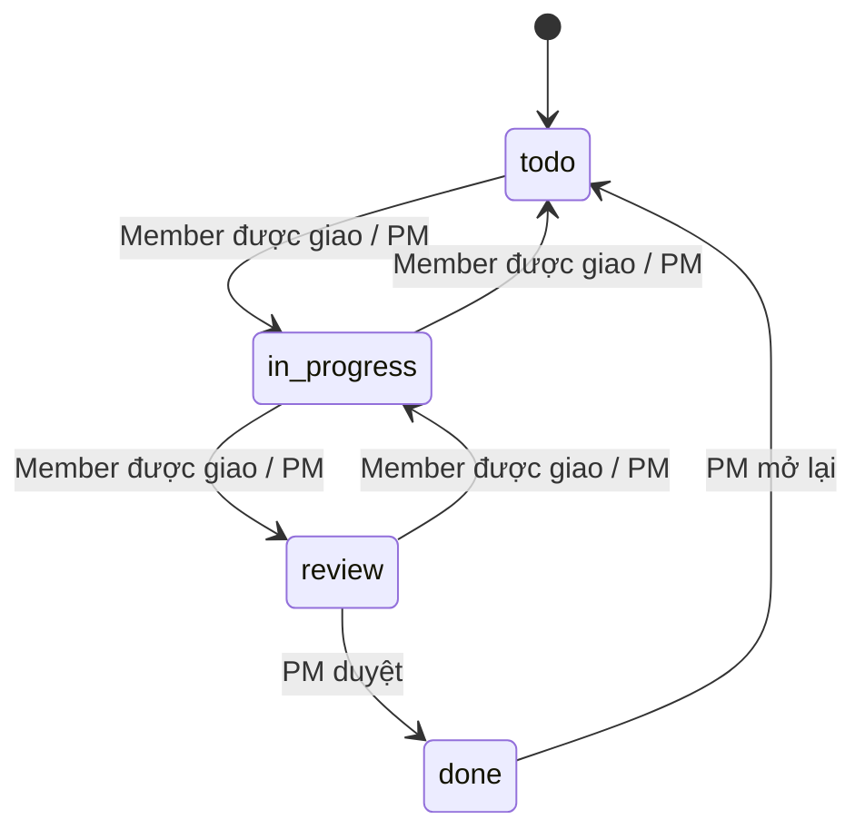

# TaskFlow — đặc tả sản phẩm đang triển khai

Version 2026-10-30. Phạm vi: mã nguồn local và baseline `DN26_CPL_Mock_Project_Nhom24 (2).xlsx`; bổ sung phần Hoàng Anh Sprint 2 theo `TaskFlow_Nhom24_SuaLoiNgay.xlsx`. Đây không phải biên bản nghiệm thu release. Hash source frontend/backend/AI/shared và Prisma: [manifest](source-manifest.json); tái sinh bằng `node scripts/generate-contract-docs.mjs`.

## Người dùng và quy trình

Nhóm học tập/dự án nhỏ 5–20 người cần giao việc, trao đổi và báo cáo có nguồn. Workspace tách nhóm; project private yêu cầu cả workspace membership và project membership. Workspace Owner/Admin không tự có quyền đọc tất cả project. Người tạo dự án trở thành PM. System Admin quản tài khoản và audit, không được mặc định đọc nội dung dự án.

Đăng ký → xác minh email → đăng nhập → workspace → project → tạo/giao task → bắt đầu → gửi Review → PM duyệt Done → dashboard/báo cáo. Lỗi mạng hoặc xung đột cần giữ nội dung đang nhập để người dùng quyết định tải lại.

## Yêu cầu chức năng và tiêu chí kiểm tra

| Story | Hành vi thực tế | Điều kiện nghiệm thu kỹ thuật |
| --- | --- | --- |
| U002/U004 | React Router, JS/TS hỗn hợp, API cookie có refresh; protected routes/logout | Build, lint, typecheck; refresh lỗi 503 không làm mất phiên; 401 thật kết thúc phiên |
| U003/U005 | Xác minh email, recovery và hồ sơ | Token một lần/hết hạn; recovery không lộ email; production SMTP TLS |
| U006–U008 | Workspace, lời mời, PM/Member/Viewer, archive | Đoán ID trả 404; Viewer không nâng quyền; không gỡ PM cuối khi chưa chuyển giao |
| U009/U010 | Form/drawer, Kanban kéo thả và nút bàn phím | Version bắt buộc khi sửa; 409 giữ draft; rollback không làm mất thẻ khác; Member không tự duyệt Done |
| U011 | My Tasks lọc người nhận/status/priority/hạn/project/search | Search debounce 300ms; phân trang 10/20/50; filter reset về trang 1; lỗi khác với kết quả rỗng |
| U013/U014 | Subtask/checklist, thread bình luận và @mention | Chỉ người trong project được nhắc; tác giả sửa/xóa; Ctrl+Enter gửi; lỗi giữ nội dung; không gửi lặp |
| U015 | Tài liệu text có revisions, upload/download PDF/TXT/PNG/JPG | ≤10MB/tệp, kiểm MIME/chữ ký đầy đủ và UTF-8; PATCH bắt buộc version, 409 giữ nội dung; proxy kiểm quyền mỗi lần; không OCR; event invalidation sau commit |
| U016/U017 | Notification dedupe, Socket.io room theo quyền | Khởi tạo prefs đồng thời không xung đột; đọc đồng bộ nhiều tab; badge theo workspace và quyền hiện tại; reconnect resync; offline báo ngay, có refresh 30 giây khi tab hiện |
| U018/U019 | Calendar/dependencies, overview và workload | Không self-link/cross-project/chu trình kể cả hai request đồng thời; dependency lặp không tăng version; Blocked suy ra và realtime cập nhật. Workload chỉ cộng task lá chưa Done/xóa đến hạn trước cuối tuần, gồm overdue; tách thiếu estimate/deadline; capacity workspace/user/week, 0 hợp lệ, CAS và audit |
| U020 | Activity và CSV | Cùng ACL/bộ lọc ngày; phân trang ổn định; whitelist cột và chống ô công thức; vượt 10.000 dòng yêu cầu thu hẹp bộ lọc, không cắt dữ liệu âm thầm; audit chỉ đọc |
| U021/U022 | AI preview/edit/approve, report draft/source/history | Không tạo task trước duyệt; approve lặp không trùng; số liệu report từ DB; nguồn đổi báo stale; lỗi lịch sử có Thử lại |
| U023/U025 | Quota, Q&A một project có citations | ACL trước/sau AI; Viewer không gọi ask; retrieval lỗi báo lỗi; không chứng cứ từ chối; không giả index nền |
| U026 | Rủi ro theo quy tắc | Quá hạn/blocked/overload từ DB; AI chỉ diễn giải |
| U028 (Should) | Admin account lock/audit đã có code | Không tự cấp admin; phiên đang mở bị chặn; không API đọc project của người khác |
| U029/U031/U032 | Đo AI, tải, khả năng truy cập và UAT | Báo số thực đo với mẫu số, build/model/dataset; không dùng test code thay người dùng thử |
| U034 | Tài liệu cài đặt, ERD/API/quyền/workflow | Đối chiếu source manifest; người khác cài sạch và reviewer xác nhận riêng |

## Ma trận quyền

| Thao tác | Workspace Owner/Admin | Project PM | Project Member | Project Viewer |
| --- | --- | --- | --- | --- |
| Tạo project | Có | Theo workspace role | Theo workspace role | Không |
| Đọc project/task/file/citation | Chỉ khi thuộc project | Có | Có | Có |
| Tạo/sửa nội dung/giao/xóa task | Theo project role | Có | Không | Không |
| Đổi trạng thái/remainingHours | Theo project role | Có | Chỉ task được giao, chưa Done | Không |
| Duyệt Done/mở lại Done | Theo project role | Có | Không | Không |
| Comment/upload/document | Theo project role | Có | Có | Không |
| Sửa/xóa comment | Chỉ comment của mình | Chỉ comment của mình | Chỉ comment của mình | Không |
| AI planner/apply/report publish | Theo project role | Có | Không | Không |
| Q&A phát sinh lượt AI | Theo project role | Có | Có | Không |
| Sửa weeklyHours | Owner: mọi membership; Admin: Member/Viewer | Chỉ nếu có quyền workspace phù hợp | Không | Không |
| Sửa giờ khả dụng một tuần | Quyền giống weeklyHours; chỉ tuần được chọn, version bắt buộc | Theo workspace role | Không | Không |
| Thay workspace Owner/Admin | Chỉ Owner | Theo workspace role | Không | Không |

Dự án archived: chỉ đọc. Restore có kiểm tra riêng tại API project; không suy luận quyền restore từ `canManage` (false khi archived). Workspace Viewer luôn là project Viewer. Quyền cuối cùng do backend quyết định, UI chỉ hỗ trợ trải nghiệm.

`Membership.weeklyHours` là mặc định. `WeeklyCapacity` khóa theo workspace/user/thứ Hai (DATE), override 0–80 giờ, giữ mặc định cho tuần chưa cấu hình. Mốc tải tuần dùng Asia/Ho_Chi_Minh thống nhất cho cả dự án. Chỉ dữ liệu project đang được phép đọc được cộng vào tải, không tổng hợp ngầm project private khác. Xóa task qua UI luôn có preview task cha/con, dependency và tệp giữ lại; token preview được kiểm tra trong transaction trước khi soft-delete.

## Trạng thái task

PM có thể đưa task về todo/in_progress/review; chỉ thêm Done từ Review (hoặc giữ Done). Done đặt completedAt; mở lại xóa completedAt. Mỗi cập nhật tăng version. Soft-delete đặt deletedAt, ẩn khỏi task/comment/AI/metrics; không có giao diện restore task.

## Kiến trúc và quyết định kỹ thuật

- FrontEnd React 18/Vite; TypeScript entry, component JS/JSX vẫn tồn tại, `checkJs=false`. Chưa coi là toàn bộ ứng dụng TypeScript.
- Backend Express/Prisma/PostgreSQL; UUID nội bộ `id` serialize thành `_id` cho UI. Socket.io theo user/project room. Xem [ERD](ERD.md) cho 23 model và FK thật.
- Upload lưu filesystem private trong UPLOAD_DIR, tải qua proxy có quyền; chưa phải object storage cloud. Backup phải bao gồm DB và UPLOAD_DIR.
- Hook useLoad cô lập state theo dependency scope, bỏ response cũ, resync khi quyền đổi/kết nối lại. Chưa dùng thư viện query cache tập trung; không tuyên bố đã có distributed cache.
- Q&A thu nguồn trực tiếp từ task/comment/text document, so fingerprint trước/sau AI; chưa có embeddings/chunks/vector index hay SQL intent chuyên dụng. `/ai/sources` là thống kê nhỏ để UI không tải hết task chỉ để đếm.
- Có Claude tùy cấu hình; không khóa API thì AI nội bộ theo quy tắc. Kết quả offline không chứng minh chất lượng hoặc chi phí Claude thật.
- Health `/api/health` xác nhận HTTP process; chưa phải health/live + health/ready như bản kế hoạch đề xuất.

## Yêu cầu phi chức năng và giới hạn

Cookie HttpOnly/SameSite; Secure ở production, CORS allowlist, header `x-taskflow: 1` cho ghi, CSRF guard, rate limit và validation. Secret ở .env ngoài Git. Không log secret. File download kiểm lại membership, không hứa thu hồi byte đã tải trước đó.

Danh sách My Tasks/documents phân trang; lịch sử AI giới hạn 10/20. Kanban vẫn tải cả board; retrieval/overview vẫn có truy vấn theo toàn project. Chưa đủ bằng chứng cho 50 user ảo/10.000 task/10 phút, p95 API <800ms hoặc AI ≤20s. Chỉ bổ sung virtual list khi profile và bằng chứng browser cho thấy cần, không biến giới hạn render thành kết quả benchmark.

Mục tiêu UAT ≥27/30, AI đúng ≥32/40, refusal ≥9/10, citation ≥90%, không rò rỉ trong 20 ca là ngưỡng của kế hoạch; xem [protocol](../validation/NHU_EVALUATION_UAT.md). Không công bố đạt trước khi chạy đúng bộ đề và chấm độc lập.
