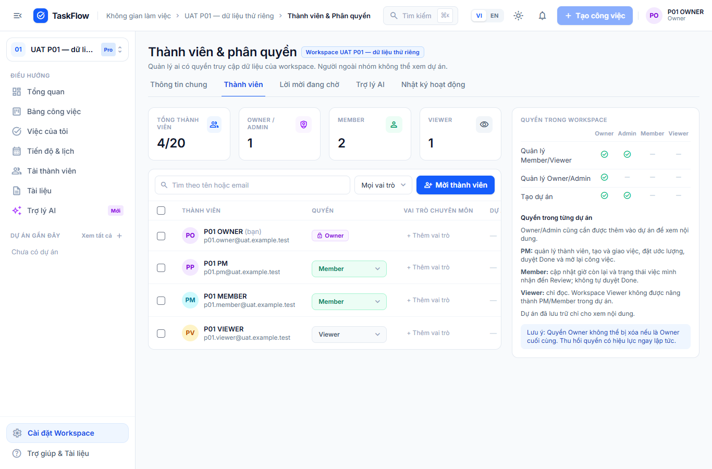
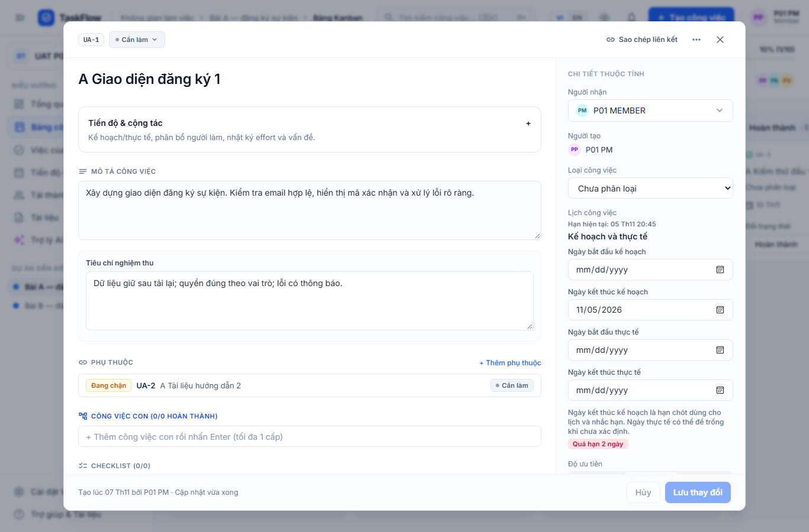
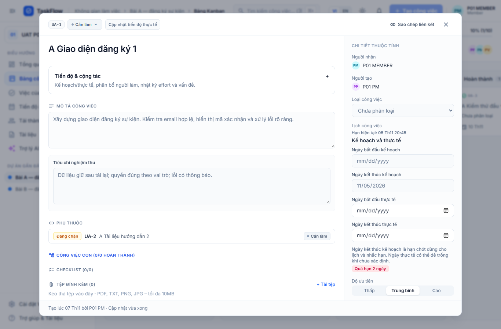
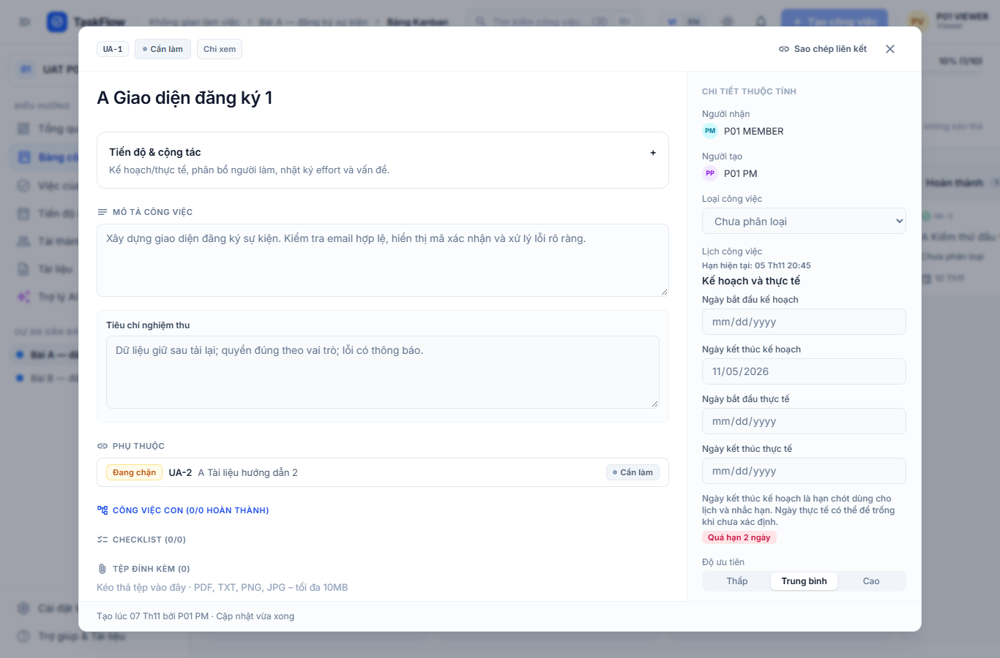

# Hướng dẫn TaskFlow theo vai trò

Ảnh dưới đây chụp từ ứng dụng đang chạy trên bộ UAT local ngày 07/11/2026, không phải mockup. Tài khoản/việc trong ảnh là dữ liệu thử. Đăng nhập, chọn workspace ở góc trái rồi chọn dự án trước khi thao tác. Một người có thể có quyền khác nhau giữa các dự án.

## Owner — quản workspace

Mở **Cài đặt Workspace → Thành viên**. Tìm người theo tên/email, xem vai trò hiện tại, mời thành viên và phân quyền phù hợp. Owner có thể quản Owner/Admin; Admin chỉ quản Member/Viewer. Không thể xóa hoặc hạ quyền Owner cuối cùng. Vai trò chuyên môn không tự cấp quyền truy cập.

Ảnh cho thấy `P01 PM` là Member của workspace nhưng là PM trong dự án. Owner đang không thuộc dự án nên mục dự án gần đây trống. Để làm việc trong dự án riêng, cần được gán vào dự án; quyền Owner không tự mở toàn bộ dữ liệu. Cấu hình AI/hạn mức nằm ở tab **Trợ lý AI** của cài đặt workspace.

## PM — giao việc và duyệt hoàn thành

Mở **Bảng công việc**, chọn dự án, bấm **Tạo công việc**. Nhập tên, mô tả, tiêu chí nghiệm thu, người nhận, estimate và hạn có căn cứ. Mở task để sửa kế hoạch/phân công; bấm **Lưu thay đổi** khi có chỉnh sửa. Thời gian thực tế được ghi riêng với kế hoạch.

Luồng trạng thái: Cần làm → Đang làm → Chờ duyệt → Hoàn thành. PM duyệt Hoàn thành từ Chờ duyệt; khi mở lại, cập nhật remaining phù hợp. Nếu có lỗi version/xung đột, tải dữ liệu mới rồi kiểm tra lại thay đổi, không ghi đè mù.

Vào **Trợ lý AI** để lập kế hoạch: nhập mục tiêu, người và ngân sách giờ; xem nháp, sửa AC/estimate/người nhận, chọn mục rồi duyệt. Chỉ khi duyệt mới tạo task. Báo cáo theo kỳ lấy số liệu từ dữ liệu dự án; bấm mã task/nguồn để đối chiếu. Diễn giải AI là đề xuất cần kiểm tra.

## Member — cập nhật công việc được giao

Mở **Việc của tôi**, lọc đúng dự án và tìm task được giao. Bắt đầu công việc, cập nhật tiến độ/remaining trong **Tiến độ & cộng tác**, ghi effort thực tế và vấn đề gây chậm khi cần. Khi đủ tiêu chí, gửi Chờ duyệt để PM quyết định.

Member không đổi người nhận, estimate hoặc tự duyệt Hoàn thành. Dùng bình luận để trao đổi và @mention đúng thành viên. Tệp được tải ở **Tải tệp** hoặc trang **Tài liệu**; lỗi sai định dạng/dung lượng phải xử lý trước khi thử lại. Tài liệu văn bản có lịch sử phiên bản; chỉnh sửa/khôi phục cần quyền ghi và version hiện tại.

Trong Q&A, hỏi dữ kiện của dự án đang chọn, mở citation để kiểm chứng. Nếu thiếu nguồn, bổ sung tài liệu đúng dự án hoặc sửa câu hỏi; không dùng câu trả lời để suy ra dữ kiện ngoài nguồn. Đổi nguồn trong lúc AI chạy có thể yêu cầu hỏi lại.

## Viewer — theo dõi và đọc

Mở dự án được cấp quyền, xem task/tài liệu và tải tệp được phép. Nhãn **Chỉ xem** và điều khiển bị khóa thể hiện quyền hiện tại. Không tạo/sửa task, bình luận, tải lên, đổi trạng thái hoặc gọi AI có tiêu hao quota.

Không thấy một dự án không có nghĩa dự án bị xóa: kiểm tra workspace đang chọn và nhờ PM xác nhận membership. Thu hồi quyền/khóa phiên có thể buộc tải lại hoặc đăng nhập lại; link cũ không vượt qua kiểm quyền.

## Khi có lỗi

- AI bận/quota hết: giữ nội dung đang nhập, xem thông báo rồi thử lại khi phù hợp; CRUD vẫn là luồng độc lập.
- File bị từ chối: kiểm tra định dạng thực và dung lượng, không chỉ đổi đuôi tên. Tệp đi qua API kiểm quyền, không chia sẻ URL bucket công khai.
- Không tải được danh sách: dùng **Thử lại** nếu có; ghi thời điểm, thao tác và ảnh thông báo để người phụ trách tái hiện.
- Đăng xuất/khóa tài khoản: phiên cũ không còn hiệu lực; chỉ đăng nhập lại khi tài khoản đã được phép.

Đối với UAT, dùng [năm kịch bản và biểu mẫu](UAT.md). Không đưa dữ liệu cá nhân hoặc mật khẩu thật vào ảnh/báo cáo.
